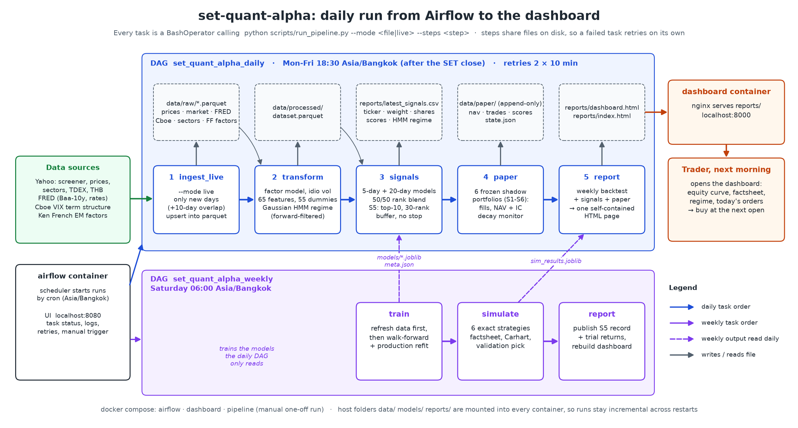
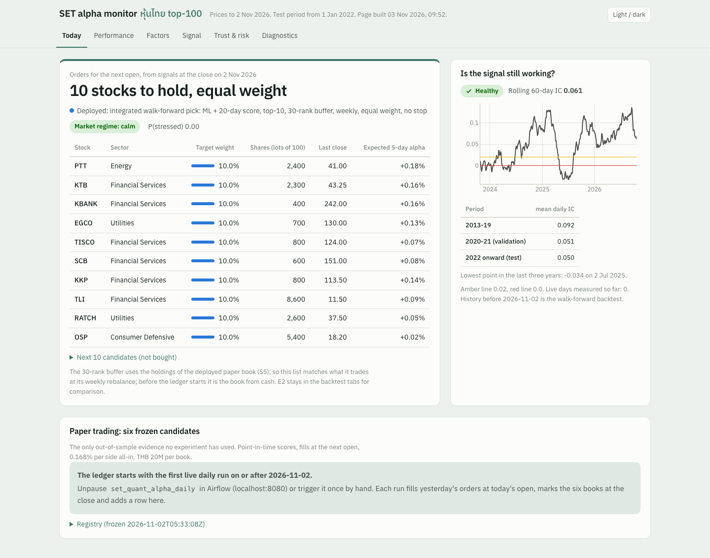

# set-quant-alpha: ML stock picking for the Thai market

An end-to-end algo-trading system for the **Stock Exchange of Thailand**:
* machine learning ranks the 100 most-traded Thai stocks by their expected next-week alpha;
* a weekly 10-stock portfolio trades on that ranking;
* Airflow runs it daily, and a dashboard shows the orders, performance and risk.

> Capstone project, DataTalksClub Stock Markets Analytics Zoomcamp 2026. Educational research, not investment advice.

| Read next | |
| --- | --- |
| [set_up_manual.md](set_up_manual.md) | set up from `git clone`, step by step (local or Docker + Airflow) |
| [strategy.md](strategy.md) | how the deployed strategy S5 works, with a flow diagram |
| [result.md](result.md) | the result in plain words, plus detailed tables |
| [docs/technical_report.md](docs/technical_report.md) | the full technical report: every section, table and experiment |

**Result (2016-26, walk-forward out of sample, after 0.168% per side Thai trading costs):**

| | S5 (deployed) | TDEX (SET50 ETF, buy and hold) |
| --- | --- | --- |
| Return per year (CAGR) | **7.4%** | 7.2% |
| Sharpe ratio | **0.57** | 0.53 |
| Worst drawdown | **−35%** | −37% |

* **The signal is real.** Rank IC 0.050 vs next-5-day alpha, positive in every year 2013-26. It stays significant
  after a multiple-testing haircut for all 795 trials (t 4.3 against a hurdle of 4.0).
* **The strategy's lead over TDEX is not statistically significant.** Trading costs take about 40% of the gross alpha.
* **Live paper trading is the real test.** It is registered from 2 November 2026.

## 1. Problem

* **Question.** After each Bangkok close, which Thai stocks should a portfolio hold for the next 5 trading days to
  beat the market after costs?
* **Why Thailand.** It is a new problem compared with the course's US large caps.
  * The SET is an emerging market: few analysts per stock, a large retail share of trading, and foreign flows that
    move with the baht.
  * Those flows push prices away from fair value for a few days, which a short-horizon model can exploit.
  * The constraints are higher costs, no easy short selling, and thin liquidity outside the top ~100 stocks.
* **How it is used.** Each evening the investor opens the dashboard or `reports/latest_signals.csv`. It lists the
  stocks to hold, their weights and share counts in 100-share lots, to trade at the next open.

## 2. Data

| Source | What | Size |
| --- | --- | --- |
| Yahoo Finance (`yfinance`, screener) | daily OHLCV of all 853 Thai common stocks, sectors, TDEX, USD/THB, EEM, S&P 500, oil, gold | **2.46M** price rows, 2010 → today |
| FRED | US 10y yield, 3m T-bill, Baa-10y credit spread | 2009 → today |
| **Cboe** CSV feed (new source) | VIX9D, VIX, VIX3M, VVIX, SKEW | 1990 → today |
| **Ken French library** (new source) | Fama-French emerging-market factors + momentum | monthly |
| Yahoo earnings and dividends | report dates, EPS surprise, dividends (research features) | per stock |
| *Optional:* **LSEG Workspace** (licensed) | point-in-time SET100 membership incl. delisted stocks, I/B/E/S estimates, fundamentals, foreign board | research only, gitignored |

* **Features.** 18 lecture features plus **47 new ones**:
  * factor betas, idiosyncratic volatility, residual momentum and reversal;
  * liquidity and microstructure;
  * 52-week range, cross-sectional ranks, market breadth;
  * HMM regime probabilities, baht / EM flow proxies, global risk, and the VIX term structure.
* **Feature dictionary.** [technical report, section 2](docs/technical_report.md#2-data-sources) and
  [notebook 02](notebooks/02_features.ipynb).
* **No data files are committed.** The pipeline downloads everything (`--mode live`) into a gitignored store.

## 3. Transformations and EDA

* **One dataframe.** `transform.build_dataset` produces 2,457,884 stock-days.
* **Feature sets.** `TO_PREDICT` (5-day return and alpha, as values and as up/down flags), `NUMERIC` (65) and
  `DUMMIES` (55), for 120 model inputs.
* **Generated dummy sets:** liquidity and momentum quintiles, RSI bucket, VIX regime, baht regime, HMM state, month,
  weekday, sector.
* **Point-in-time universe:**
  * liquid = 60-day median traded value ≥ THB 20M;
  * tradable = the 100 most traded liquid stocks that day.
* **Target.** 5-day alpha: buy at the next open, sell at the close 5 days later, net of beta × market.
* **EDA** ([notebook 01](notebooks/01_data_eda.ipynb)):
  * the target is balanced (47.5% positive);
  * the strongest correlations are low-volatility / low-beta effects (vol_60 −0.061, beta −0.055);
  * every single-feature correlation is below 0.07, so a model that combines weak signals is needed.

## 4. Modeling

| Model | Test IC (t, overlap-robust for the ensemble) | Test top-decile 5-day alpha |
| --- | --- | --- |
| DecisionTree, RandomForest (lecture) | 0.033, 0.058 | +0.02%, +0.33% |
| Logistic regression, **XGBoost** (new) | 0.045, 0.049 | +0.23%, +0.27% |
| **Ensemble: logistic + XGBoost** | **0.050 (t 5.6)** | +0.26% |

* **Splits.** Train 2010-19, validate 2020-21, test 2022 onward, with a 5-day embargo. The models are refit each
  January walk-forward.
* **Tuning.** A grid search on the validation years, judged by the alpha of the top-decile picks (`reports/tuning_log.csv`).
* **Custom decision rules.** Probability above the validation 95th percentile, the daily top-5, or both models
  agreeing. Precision rises from 49.8% to 55.8% at the 98th percentile.
* **Frozen design.** `models/best_params.json` is committed and the ensemble is pinned (`config.ENSEMBLE`), so retraining
  updates the weights, not the design.

## 5. Trading simulation

* **Vector simulations.** Six strategies, `sim1_`-`sim6_` (threshold, top-5, regime filter, agreement, long-short,
  conviction sizing), each with approximate returns on capital.
* **Exact simulations.** Day by day, THB 1M, profits reinvested, 100-share lots, next-open fills, 0.168% per side.
  E1-E6 cover equal weight, a 30-rank buffer + 8% stop, mean-variance (Ledoit-Wolf), an HMM regime filter, a beta
  hedge, and volatility targeting.
* **Best strategy, S5** ([strategy.md](strategy.md)): a 50/50 blend of the 5-day model and a 20-day model, holding
  the top 10, keeping held stocks while they rank in the top 30, rebalanced weekly, equal weight.
  * It was chosen by walk-forward selection over 576 designs, using only earlier years each time.
  * It beat TDEX after costs, by 7.4% vs 7.2% CAGR.
* **Deep analysis.**
  * Precision and alpha by sector, year, regime and size.
  * Signal decay by horizon, Fama-MacBeth tests and factor attribution (CAPM, Fama-French, Carhart; EM and local Thai).
  * Overfitting checks: deflated Sharpe, PBO, Harvey-Liu-Zhu haircuts.
  * Details are in [technical report, sections 5-6](docs/technical_report.md#5-trading-simulation).
* **Research extensions.** 795 pre-registered trials, each counted in the significance tests, for example:
  * cost-aware and optimiser designs;
  * published factor strategies;
  * survivorship bias, analyst data, foreign flows and adaptive weights from LSEG.

  None beat S5 in both 2013-21 and 2022-26. Each has a `REPORT.md` in [experiments/](experiments/).

## 6. Automation and services



| Service | Where | What it does |
| --- | --- | --- |
| Airflow (`docker compose`) | <http://localhost:8080> | **daily** DAG Mon-Fri 18:30 Bangkok (new data → signals → paper trading → dashboard); **weekly** DAG Saturday 06:00 (data → retrain → backtests → dashboard); optional **LSEG** DAG, skipped without a key |
| Dashboard (nginx) | <http://localhost:8000> | six tabs: Today (orders, signal health), Performance, Factors, Signal, Trust & risk, Diagnostics |
| Pipeline CLI | `scripts/run_pipeline.py` | one entry point for cron, Airflow, Docker and [notebook 05](notebooks/05_master_workflow.ipynb) |

* **Two regimes.**
  * `--mode live` downloads only the new days and upserts them into the parquet store.
  * `--mode file` runs from the stored data with no network. The store can live on a synced drive folder
    (`SETALPHA_DATA_DIR`).
* **Dependencies.** One `uv` environment (`pyproject.toml` + `uv.lock`); `requirements.txt` for the Docker images.
* **Monitoring.** Six frozen paper-trading shadows, an append-only ledger, and a rolling-IC signal-decay alert.



More screenshots: [dashboard tour](docs/technical_report.md#92-dashboard-tour).

## 7. How to run

```bash
git clone https://github.com/PathornKiti/stock-markets-analytics-zoomcamp-pathorn.git
cd stock-markets-analytics-zoomcamp-pathorn
make setup                                                    # uv environment
uv run set-quant-alpha/scripts/run_pipeline.py --mode live    # download, train, backtest, signals, dashboard
open set-quant-alpha/reports/dashboard.html
```

With Docker:
1. Run `cd set-quant-alpha && docker compose up -d --build`.
2. In Airflow, trigger `set_quant_alpha_weekly` once, then unpause `set_quant_alpha_daily`.

The full guide, including LSEG, is [set_up_manual.md](set_up_manual.md).

## 8. Layout

```
set-quant-alpha/
├── src/setalpha/          library: ingest, transform, model, strategy, portfolio, regime, evaluate, factors,
│                          signal_eval, validity, risk, paper, report, dashboard, pipeline
├── scripts/               run_pipeline.py (entry point), fetch_lseg.py, fetch_events.py, trial_returns.py
├── notebooks/             01 EDA · 02 features · 03 modeling · 04 simulation · 05 master workflow
├── airflow/               Dockerfile + DAGs (daily, weekly, LSEG)
├── experiments/           one folder per pre-registered experiment, each with REPORT.md
├── docs/                  technical report, flow diagrams, dashboard screenshots
├── tests/                 24 unit tests
└── docker-compose.yml, Dockerfile, requirements.txt, .env.example
```
