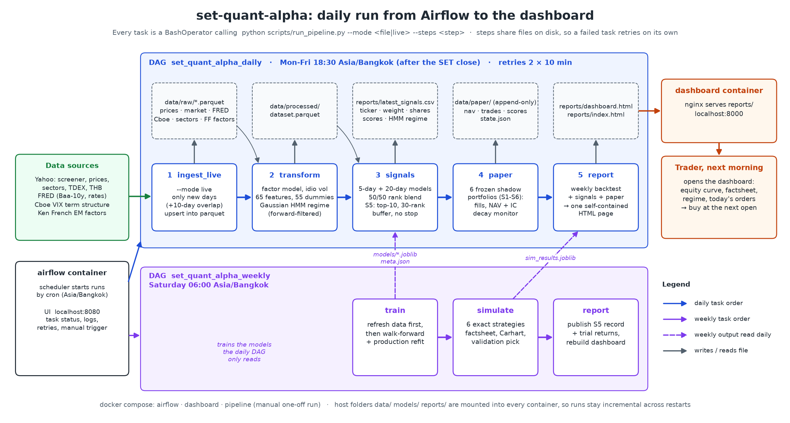
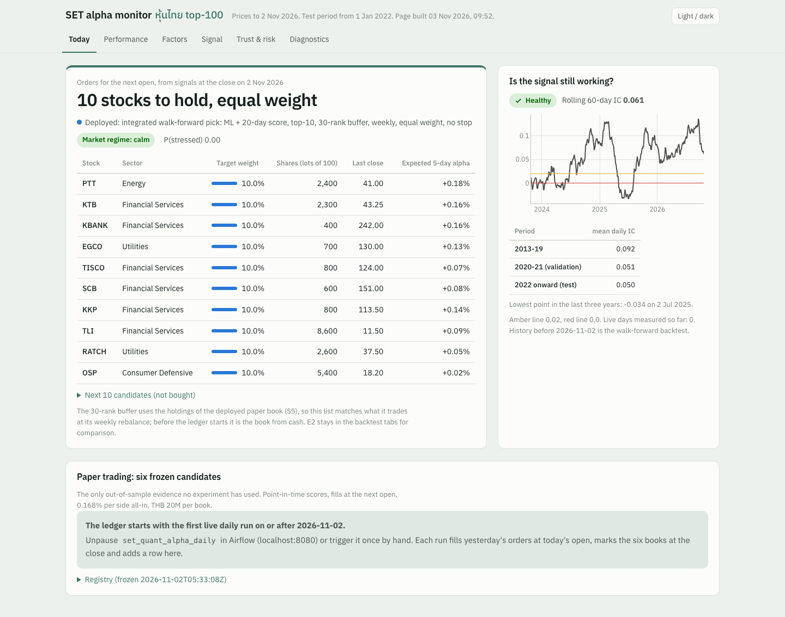
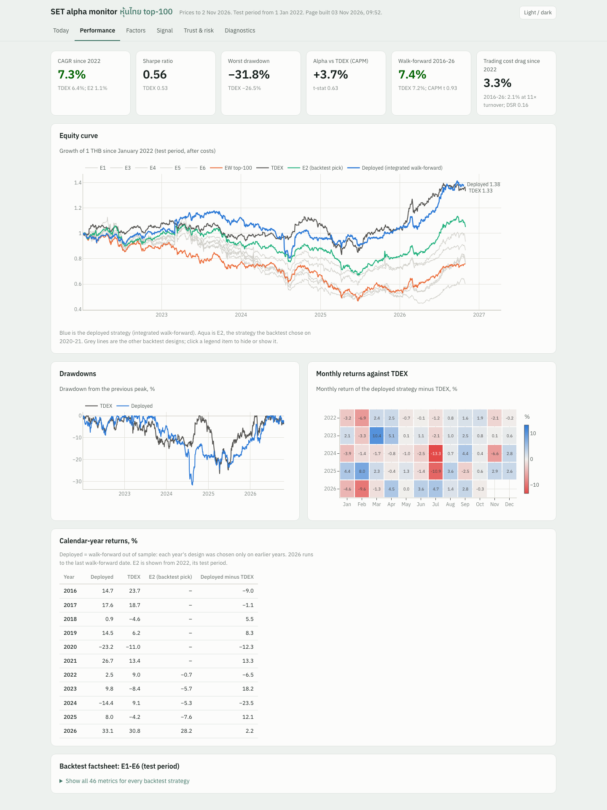
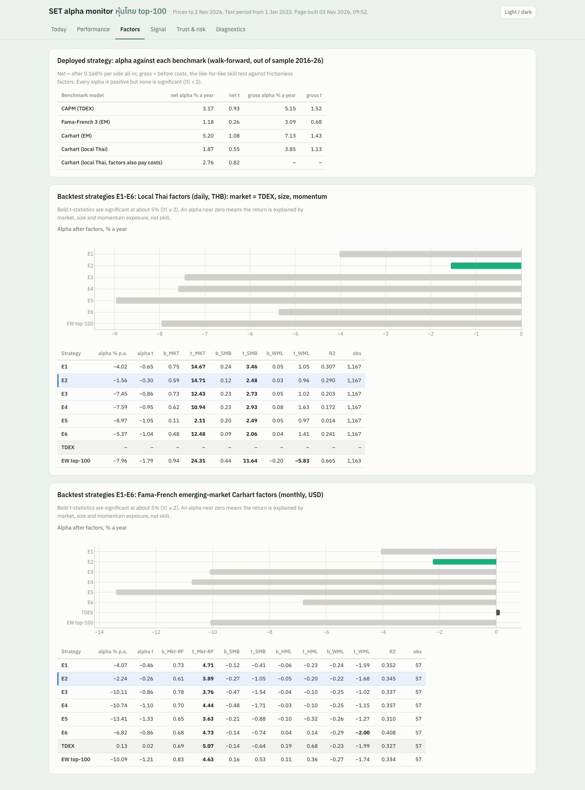
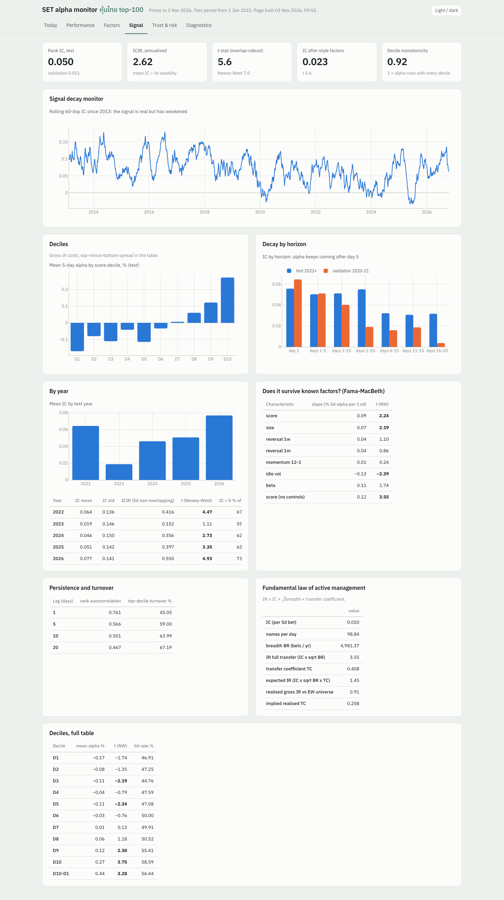
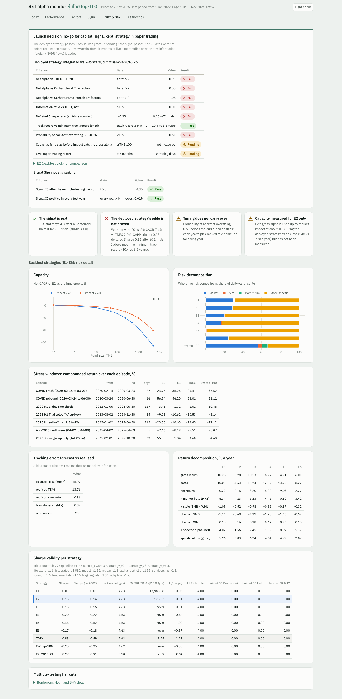
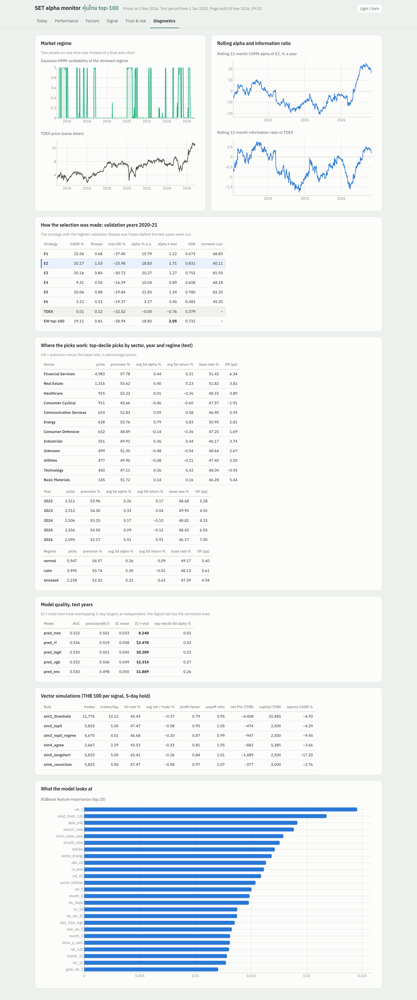

# set-quant-alpha - technical report

The full write-up behind the short [README](../README.md): every section, table and experiment.

An end-to-end algo-trading system for the **Stock Exchange of Thailand (SET / mai)**. It combines a
**machine-learning alpha layer** (which stocks will beat the market over the next week?) with a
**quantitative-finance layer** (factor model, HMM market regimes, shrinkage risk model, mean-variance
optimisation, volatility targeting, and Sharpe-ratio statistics that correct for luck). Airflow
runs it every trading day, and docker compose packages it.

> Capstone project for the DataTalksClub Stock Markets Analytics Zoomcamp 2026.
> Educational research, not investment advice.

**Contents:** [Problem](#1-problem-description) · [Data](#2-data-sources) · [Transformations & EDA](#3-data-transformations--eda) ·
[Modeling](#4-modeling) · [Trading simulation](#5-trading-simulation) ·
[Quant evaluation framework](#6-quant-evaluation-framework) · [Research extensions & all trials](#7-research-extensions--all-trials) ·
[Model card & governance](#8-model-card--research-governance) · [Automation](#9-automation) ·
[Reproduce](#10-how-to-reproduce) · [Layout](#11-project-layout) · [Findings & next steps](#12-findings-difficulties-and-next-steps)

---

> **Set up from `git clone`, step by step:** [set_up_manual.md](../set_up_manual.md).
>
> **How the deployed strategy S5 works (with a flow diagram):** [strategy.md](../strategy.md).
>
> **Headline result and how it was tested:** [result.md](../result.md). The deployed strategy beat TDEX out of sample
> after realistic Thai trading costs (7.4% vs 7.2% CAGR, 2016-26), with positive but not significant alpha against
> CAPM, Fama-French and Carhart.

## 1. Problem description

**Question.** Each evening after the Bangkok close, which Thai stocks should a portfolio hold for the next five
trading days so that it beats the market after costs, at a risk level the investor chooses?

**Why Thailand.** Most course projects trade US large caps, which are among the most efficient markets in the world.
The SET is an emerging market with fewer analysts per stock, a large retail share of trading, and heavy
foreign-investor flows that move with the baht and global risk appetite. Those flows push prices away from
fundamentals for a few days (price pressure), which is where a short-horizon model can find an edge. The trade-off
is that costs are higher, short selling is restricted, and liquidity is thin outside the largest ~100 names. The
design deals with these explicitly.

**What the system does, end to end**

1. Discovers every Thai common stock (~850) and downloads 16 years of daily prices plus global market, rates, and
   volatility data from four sources.
2. Estimates a rolling **single-index factor model** for every stock and splits each return into a market part and a
   stock-specific part (*alpha*).
3. Detects the **market regime** (calm / normal / stressed) with a Gaussian **Hidden Markov Model**.
4. Builds one combined dataset of ~2.46M rows and 138 columns, and trains **DecisionTree, RandomForest, Logistic
   regression and XGBoost** to predict whether a stock's 5-day forward alpha will be positive. Test years are
   predicted walk-forward.
5. Converts the scores into expected returns with **Grinold's rule** (alpha = IC x volatility x score), then builds the
   portfolio with **Ledoit-Wolf covariance + mean-variance optimisation + 15% volatility targeting**, an 8% stop-loss,
   and optional regime de-risking or beta hedging.
6. Simulates six vector strategies and six exact (day-by-day, reinvested, lot-size and cost-aware) strategies
   against the SET50 ETF, and reports CAGR, Sharpe, drawdown, CAPM alpha, and the Probabilistic / Deflated Sharpe
   ratio.
7. Evaluates the result the way a buy-side research review would (section 6):
   * an alphalens-style **signal tear-sheet**: IC / ICIR, decay, deciles, Fama-MacBeth, transfer coefficient;
   * **statistical validity**: Lo Sharpe, minimum track record length, Harvey-Liu-Zhu haircuts for all 795 trials,
     probability of backtest overfitting;
   * **risk and capacity**: ES 97.5%, stress windows, ex-ante vs realised tracking error, square-root-impact
     capacity curve.
8. Every trading day at 18:30 Bangkok time, an Airflow DAG downloads the new data incrementally, scores the stocks,
   and publishes **next-day orders** and an **HTML dashboard**.

**Who uses it and how.** A discretionary or systematic investor in Thai equities reads
`reports/latest_signals.csv` (or the dashboard) each evening. It lists the stocks to hold, target weights, and share
counts in 100-share board lots. The investor places the orders before the next open.

**What is new compared with the course setup:** a different exchange (Thailand) at a 5-day horizon; a residual-alpha
target instead of a raw return; trading on next-open fills; a quant portfolio layer; HMM regimes; and a check that
the result isn't luck (DSR).

---

## 2. Data sources

| # | Source | What it provides | Range | Rows |
| --- | --- | --- | --- | --- |
| 1 | **Yahoo Finance screener** (`yf.screen`, region = th) | every Thai common stock listed on SET / mai (DRs, warrants, NVDR/foreign lines and funds removed) | current | 853 tickers |
| 2 | **Yahoo Finance prices** (`yfinance`) | daily OHLCV of 853 Thai stocks (adjusted) | 2010-01 → today | **2.46M** |
| | | global series: USD/THB, EEM, S&P 500, dollar index, oil, gold, TDEX (SET50 ETF, benchmark) | 2009 → today | 31k |
| | | sector / industry profile of each stock | current | 853 |
| 3 | **FRED** (`pandas-datareader`) | US 10y yield, 3m T-bill, Moody's Baa-10y credit spread, THB/USD | 2009 → today | 4.7k days |
| 4 | **Cboe daily CSV feed** (*new source, not yfinance / FRED*) | VIX9D, VIX, VIX3M (volatility term structure), VVIX, SKEW | 1990 → today | 9.3k days |
| 5 | **Kenneth French data library** (`pandas-datareader`) | Fama-French Emerging Markets 5 factors + momentum, for Carhart attribution | 2005 → 2026-09 (monthly) | 261 months |
| 6 | **Yahoo earnings calendars and dividends** (research data) | report dates with EPS estimate / reported / surprise %, and dividends, per stock (`ingest.ingest_events`; refreshed on demand by `scripts/fetch_events.py`, not by the daily run) | earnings 2004 → today (42-81% of tradable stock-years since 2013); dividends 2000 → today | 13.9k dividend rows |
| (opt.) | SET website, exported by hand | daily net trading by investor type (foreign / institution / proprietary / retail) | - | joined if `data/external/set_investor_type.csv` exists |
| (opt.) | SET / Thai NVDR website, exported by hand | daily NVDR buy / sell value **per stock** (mostly foreign money: a per-stock foreign-flow proxy) | - | read if `data/external/nvdr_by_stock.csv` exists |
| (opt.) | **LSEG Workspace** (licensed, `scripts/fetch_lseg.py`, `uv sync --group lseg`) | point-in-time SET50/SET100 membership with delisted stocks, their prices and total returns, foreign-board (`_f.BK`) history | 2009 → today | 263 SET100 RICs; research only, gitignored |

The combined dataset has **2,457,884 rows** (stock-days), 83 columns before dummies and 138 after.

Notes:
* The SET website blocks automated downloads, so investor-type flows are not scraped. Foreign-flow behaviour is
  proxied by the baht, the EM ETF (price and volume shocks), and stock betas to both. The optional CSV hook lets the
  real series be added by hand (the planned master-thesis extension). Templates for both hand-collected files are in
  [docs/templates/](templates/): copy the day's table from the SET website after the close and append one row
  per day (and per stock for NVDR). Collecting from today gives a forward, point-in-time dataset.
* External flow and event data are **research features**: `config.USE_FLOW_FEATURES = False` keeps them out of the
  production model, because a new feature would silently change the signal of the frozen paper shadows (9.1).
  `setalpha/events.py` builds them point-in-time (earnings reactions known from E+1, NVDR lagged one day).
* Yahoo has no usable SET-index history, so the benchmark is the **TDEX ThaiDEX SET50 ETF**, an investable SET50
  tracker.
* The stock list is today's listings, so stocks delisted before 2026 are missing (survivorship bias; see sections 8 and 12).
  An LSEG point-in-time SET100 check ([survivorship_v1](../experiments/survivorship_v1/REPORT.md)) finds the effect small
  and not significant (S5 rule −0.4 points a year over 2013-26, t −0.2; signal IC unchanged).

### Features

Lecture features (18): returns over 1/5/10/20/60/120 days, 20/60-day volatility, close / SMA 10/20/50/200, RSI-14,
MACD histogram, Bollinger %B, ATR-14, change in the US 10y yield, 3m T-bill.

**New features (47)**, all known at the Thai close (US, FRED, and Cboe data lagged one day):

| Group | Features | Definition / rationale |
| --- | --- | --- |
| Factor model | `beta_mkt`, `beta_thb`, `beta_eem` | 120-day rolling betas to the equal-weight Thai market, USD/THB and EEM: market risk and sensitivity to foreign flows |
| | `idio_vol` | 60-day std of the residual return: idiosyncratic-volatility effect; also scales alpha in the optimiser |
| | `resid_rev_5`, `resid_mom_20`, `resid_mom_120` | sums of residual returns: short-term reversal (liquidity provision) and residual momentum |
| Liquidity | `log_dvol60`, `vol_z20`, `amihud_20`, `zero_ret_20` | traded value, volume shock, Amihud illiquidity, share of zero-return days |
| Microstructure | `gap_1`, `range_1`, `max_ret_20` | overnight gap, intraday range, lottery-stock MAX effect |
| Range / relative | `dist_52w_high`, `dist_52w_low`, `rel_ret_5`, `rel_ret_20` | anchoring to 52-week extremes; return relative to the market |
| Cross-sectional ranks | `cs_ret_5`, `cs_ret_20`, `cs_resid_mom_20`, `cs_vol_20`, `cs_dvol` | daily percentile among liquid stocks (scale-free) |
| Thai market | `mkt_ret_1`, `mkt_ret_5`, `breadth`, `dispersion` | market return, share of advancing stocks, cross-sectional dispersion |
| HMM regime | `hmm_p_calm`, `hmm_p_stressed` | filtered probabilities from the Gaussian HMM |
| Foreign-flow proxies | `usdthb_ret_1/5`, `usdthb_vol_20`, `eem_ret_1/5`, `eem_vol_z` | baht moves and volatility, EM ETF returns and volume shocks |
| Global risk | `spx_ret_5`, `dxy_ret_5`, `oil_ret_5`, `gold_ret_5`, `credit_spread`, `credit_spread_chg_5` | risk appetite, commodities, credit stress |
| Cboe volatility | `vix`, `vix_slope` (VIX/VIX3M), `vix9d_ratio`, `vvix`, `skew`, `vix_chg_5` | level and term structure; backwardation signals stress |

The full dictionary is in [notebooks/02_features.ipynb](../notebooks/02_features.ipynb).

---

## 3. Data transformations + EDA

* **One combined dataframe** (`transform.build_dataset`): stock prices pivoted to Date x Ticker, all features computed
  in wide form, stacked to a long table, and joined with the lagged global, FRED, Cboe, and HMM data.
* **Feature sets** (`transform.feature_sets`): `TO_PREDICT = [fwd_ret_5, fwd_alpha_5, is_alpha_5, is_positive_5]`,
  `NUMERIC` (65 = 18 lecture + 47 new), and `DUMMIES` (55 one-hot columns); 120 model inputs in total.
* **Generated transformations** (binned into dummies): liquidity quintile `size_q`, momentum quintile `mom_q`, RSI
  bucket `rsi_bin`, VIX regime `vix_regime`, baht regime `thb_regime`, HMM state `hmm_state`, plus `month`,
  `weekday` and `sector`.
* **Universe flags** (point-in-time, no look-ahead): `liquid` = 60-day median traded value ≥ THB 20M and price ≥ THB 1
  (training rows); `tradable` = the 100 most traded liquid stocks that day (a point-in-time "SET100").
* **Targets**: buy at the next open, sell at the close 5 days later; alpha = return - beta x market return over the
  same window.
* **EDA** ([01_data_eda.ipynb](../notebooks/01_data_eda.ipynb)): coverage by year and sector, target distribution, Spearman
  correlation of every feature with the target (training years only), the feature correlation heat-map, and HMM
  regime statistics.

**EDA highlights** (training years 2010-2019 only):

* The target is close to balanced: 47.5% of tradable stock-weeks have positive alpha. Its distribution has fat
  tails (1st / 99th percentiles of 5-day alpha -11.4% / +13.5%).
* The strongest single correlations with forward alpha are all **risk measures with a negative sign**: `vol_60`
  -0.061, `idio_vol` -0.059, `beta_mkt` -0.055, `atr_14` -0.051. This is the low-volatility / low-beta anomaly. On the
  positive side: `dist_52w_high` +0.044 (stocks near their 52-week high keep doing well), `resid_mom_120` +0.026, and
  liquidity `log_dvol60` +0.021. All single correlations are below 0.07, so a non-linear model that combines many weak
  signals is needed.
* **HMM regimes** (fitted to 2021): *calm* (10.5% annual vol, lasts ~52 days on average), *normal* (17%, ~22 days)
  and *stressed* (31%, ~35 days). The average next-5-day market return is highest after **stressed** days (+0.27% vs
  +0.11% calm). Rebounds after stress are where a liquidity provider gets paid.

---

## 4. Modeling

| Model | Library | Role |
| --- | --- | --- |
| DecisionTree | scikit-learn | lecture model, interpretable baseline |
| RandomForest | scikit-learn | lecture model |
| Logistic regression | scikit-learn | linear benchmark (standardised features) |
| XGBoost | xgboost | gradient boosting (new) |
| Ensemble | - | average daily percentile rank of the two families with the best validation top-decile alpha (chosen by rule: logistic + XGBoost) |

* **Chronological splits**: train 2010-2019, validation 2020-2021, test 2022 → today, with a 5-day embargo at each
  boundary (the 5-day targets overlap).
* **Hyperparameter tuning**: a grid per model on the validation years. Models are selected by the 5-day alpha of each
  day's top-10% picks (what the strategy trades); AUC is reported alongside. Log: `reports/tuning_log.csv`.
* **Walk-forward test**: every model is refit each January on all earlier data, then predicts that year.
* **Custom decision rules**: trades only on the highest-probability events (probability above the validation 95th
  percentile, the daily top-5 of the ensemble, or both models agreeing).
* **Quant layer** (`setalpha/portfolio.py`, `setalpha/regime.py`): Grinold alpha scaling, Ledoit-Wolf covariance,
  long-only mean-variance with a 15% name cap, volatility targeting, RiskMetrics EWMA, fractional Kelly, parametric
  VaR, and a Gaussian HMM with forward filtering (unit-tested in `tests/test_quant.py`).

**Results** (daily IC = Spearman correlation between score and realised 5-day alpha among tradable stocks):

| Model | valid AUC | valid top-decile 5d alpha | **test AUC** | **test IC (t-stat)** | **test top-decile 5d alpha** |
| --- | --- | --- | --- | --- | --- |
| DecisionTree | 0.524 | +0.17% | 0.522 | 0.033 (8.2) | +0.02% |
| RandomForest | 0.529 | +0.02% | 0.536 | 0.058 (13.5) | +0.33% |
| Logistic | 0.525 | **+0.31%** | 0.530 | 0.045 (10.2) | +0.23% |
| XGBoost | 0.529 | +0.24% | 0.532 | 0.049 (12.3) | +0.27% |
| **Ensemble (logit + XGB)** | 0.527 | +0.15% | 0.530 | **0.050 (11.9)** | **+0.26%** |

The t-stats in this table treat every daily IC as independent. Because the 5-day targets overlap, the honest
t-stat of the ensemble IC is **7.0 (Newey-West) or 5.6 (every 5th day only)**. That still clears the
Harvey-Liu-Zhu t > 3 hurdle with room to spare (section 6.1).

* An AUC around 0.53 looks small, but a daily IC of 0.05-0.06 over ~100 stocks is a usable signal by the
  fundamental law of active management (IR ≈ IC × √breadth; measured with the portfolio's transfer coefficient in
  section 6.1). It is also stable: the top-decile precision beats the base rate by 4-7 percentage points in
  **every** test year (2022: +5.3, 2023: +4.5, 2024: +4.3, 2025: +6.0, 2026: +7.0).
* Custom rules concentrate on high-probability events: test precision rises from 49.8% (XGB probability above the
  validation median) to 52.8% (above the 95th percentile) and 55.8% (98th). The 5-day alpha rises from +0.06% to
  +0.53%.
* Tuned parameters: tree depth 6; RF depth 8; logistic C = 1; XGBoost depth 3, learning rate 0.08, 300 trees.
  The most important XGBoost inputs: 1-day return (reversal), 120-day residual momentum, market beta, SMA ratios,
  HMM calm-state dummy, T-bill rate, sector, idiosyncratic volatility.

---

## 5. Trading simulation

Test period: **2022-01 → 2026-10**, walk-forward predictions only. Costs: 0.15% per side (commission + VAT + spread);
0.05% per side for the ETF hedge.

**Vector simulations** (`sim1_`…`sim6_` fields per prediction; THB 100 per signal, 5-day hold):

| Strategy (test 2022 → 2026-10) | rule | trades | hit rate | avg net / trade | approx. CAGR on capital used |
| --- | --- | --- | --- | --- | --- |
| `sim1_threshold` | logistic probability ≥ validation 95th pct | 11,776 | 45.6% | -0.34% | -4.4% |
| `sim2_top5` | 5 best ensemble scores per day | 5,820 | 47.6% | -0.05% | -2.3% |
| `sim3_top5_regime` | sim2, only when HMM calm & VIX < VIX3M | 4,640 | 46.9% | -0.17% | -7.4% |
| `sim4_agree` | both ensemble members above their thresholds | 2,667 | 43.7% | -0.29% | -3.2% |
| `sim5_longshort` | sim2 long, short SET50 ETF | 5,820 | 46.0% | -0.22% | -13.9% |
| `sim6_conviction` | sim2 with 1.5× stake on the top-2 | 5,820 | 47.6% | -0.05% | -0.9% |

Every daily-entry vector strategy loses money after 0.30% round-trip costs. Paying the full spread on a new
5-day trade every day costs more than the ~0.3% weekly alpha the signal earns.

**Exact simulations**: THB 1,000,000 start, profits reinvested, 100-share lots, weekly rebalance at the next open,
stop-loss checked on each day's low:

The strategy marked * was chosen **automatically before looking at the test years**: it had the highest Sharpe on the
2020-2021 validation years (validation Sharpe 1.06, CAGR 20.9%, max DD -25.9%).

| Test 2022-01 → 2026-10 | CAGR | vol | Sharpe | Sortino | max DD | CAPM alpha / yr | beta | PSR | DSR | trades |
| --- | --- | --- | --- | --- | --- | --- | --- | --- | --- | --- |
| E1 equal-weight top-10 | -0.4% | 18.3% | 0.07 | 0.10 | -45.7% | -3.9% | 0.73 | 0.56 | 0.35 | 2,825 |
| **E2 equal top-10 + 30-rank buffer + 8% stop** * | **+1.6%** | 14.8% | 0.18 | 0.25 | -36.3% | -1.4% | 0.58 | 0.65 | 0.44 | 1,368 |
| E3 mean-variance (Grinold alpha, Ledoit-Wolf) + stop | -4.0% | 22.0% | -0.08 | -0.11 | -56.4% | -6.7% | 0.71 | 0.44 | 0.24 | 1,939 |
| E4 E3 + HMM regime filter | -4.2% | 20.3% | -0.11 | -0.17 | -54.4% | -6.5% | 0.60 | 0.41 | 0.22 | 1,928 |
| E5 E3 beta-hedged with SET50 ETF (long-short) | -9.0% | 19.5% | -0.39 | -0.61 | -56.3% | -8.2% | 0.10 | 0.21 | 0.09 | 1,939 |
| E6 conservative MVO + 15% vol target | -2.2% | 13.0% | -0.10 | -0.15 | -35.4% | -4.7% | 0.47 | 0.41 | 0.22 | 2,297 |
| **TDEX SET50 ETF buy & hold (benchmark)** | **+6.4%** | 13.5% | 0.53 | 0.75 | -26.5% | - | 1.00 | 0.87 | - | 0 |
| Equal-weight tradable top-100 (no costs) | -5.8% | 17.5% | -0.25 | -0.36 | -53.8% | -12.0% | 0.99 | 0.29 | - | 0 |

**Verdict: the best strategy does not beat the SET50 benchmark after costs in 2022-2026.** It does beat its own
investable universe by about 7% a year, and before costs the plain top-10 book earns **9.0% CAGR, above the
benchmark's 6.4%** (cost sensitivity below).

### Factsheet metrics

`evaluate.perf_stats` reports the metrics professional active-fund and algo-trading evaluation uses. The
dashboard and [04_simulation.ipynb](../notebooks/04_simulation.ipynb) show them in five groups:

| Group | Metrics |
| --- | --- |
| Return & risk-adjusted | CAGR, best / worst year, volatility, Sharpe, Sortino, Calmar, Omega |
| Benchmark-relative | excess CAGR, tracking error, information ratio, CAPM alpha (Newey-West t), beta, Treynor, up / down capture, batting average |
| Drawdown & tail | max drawdown, max drawdown duration, Ulcer index, 1-day VaR / CVaR 95%, **Expected Shortfall 97.5% (1-day and 10-day, Basel FRTB)**, skew, kurtosis |
| Trading & implementation | exposure, turnover, trades, gross CAGR (zero-cost rerun), cost drag, **break-even cost vs TDEX and vs the EW universe**, gross CAPM alpha and **alpha per 1× turnover**, hit rate, profit factor, payoff ratio |
| Robustness | PSR, DSR, 5-95% block-bootstrap Sharpe interval, **Lo (2002) autocorrelation-adjusted Sharpe**, **minimum track record length** vs the actual track record |

Signal research, multiple-testing haircuts, PBO, stress tests, capacity and the reporting tables are in
[section 6](#6-quant-evaluation-framework).

Key rows for the test period, with the selected strategy E2 next to the benchmark:

| Metric | E2 (selected) | E1 equal top-10 | TDEX |
| --- | --- | --- | --- |
| CAGR / excess CAGR | +1.6% / -4.8% | -0.4% / -6.8% | +6.4% |
| Sharpe (5-95% bootstrap) | 0.18 (-0.48 to 1.08) | 0.07 (-0.55 to 0.90) | 0.53 (-0.26 to 1.34) |
| Information ratio / tracking error | -0.32 / 13.8% | -0.37 / 15.8% | - |
| Up / down capture | 78% / 98% | 81% / 113% | 100% / 100% |
| Batting average (months beating TDEX) | 48% | 41% | - |
| Max drawdown / longest drawdown | -36% / 786 days | -46% / 1,093 days | -27% / 411 days |
| Turnover / cost drag | 27× / 4.2% a year | 59× / 9.4% a year | - |
| **Break-even cost vs TDEX** | < 0 (gross 5.9% < 6.4%) | **0.04% per side** | - |

The Sharpe intervals overlap heavily: 4.8 years cannot statistically separate any strategy from the benchmark. The
capture ratios show the problem: in the months TDEX fell, the strategies fell just as much or more.

### Factor attribution (Fama-French / Carhart four-factor model)

`setalpha/factors.py` runs the Carhart (1997) regression r - rf = alpha + b<sub>MKT</sub>MKT + b<sub>SMB</sub>SMB +
b<sub>HML</sub>HML + b<sub>WML</sub>WML two ways:

**1. Fama-French Emerging Markets factors** (Ken French data library, the project's 5th data source; monthly, USD;
strategy returns converted from THB with USD/THB):

| Test 2022-26, monthly | alpha % p.a. (t) | b Mkt | b SMB | b HML | b WML | R² |
| --- | --- | --- | --- | --- | --- | --- |
| E2 (selected) | -1.7 (-0.19) | 0.61** | -0.26 | -0.05 | -0.22 (t -1.7) | 0.34 |
| E1 | -3.1 (-0.34) | 0.74** | -0.11 | -0.05 | -0.24 (t -1.6) | 0.35 |
| TDEX | +0.1 (0.02) | 0.69** | -0.14 | 0.19 | -0.23 (t -2.0) | 0.33 |

** = |t| > 3. Global EM factors explain only about a third of Thai returns. The negative momentum loading fits a
short-term-reversal signal.

**2. Local Thai factors** (daily, THB): MKT = SET50 ETF; SMB = smaller minus larger half of liquid stocks (by traded
value); WML = 12-1 month momentum winners minus losers. No HML, because book values are not in free data.

| Test 2022-26, daily | alpha % p.a. (t) | b MKT | b SMB (t) | b WML | R² |
| --- | --- | --- | --- | --- | --- |
| E2 (selected) | -1.0 (-0.19) | 0.60 | **0.13 (2.5)** | 0.03 | 0.29 |
| E1 | -2.9 (-0.48) | 0.75 | **0.24 (3.5)** | 0.05 | 0.31 |
| EW top-100 universe | -8.0 (-1.79) | 0.94 | **0.44 (11.6)** | -0.20 | 0.67 |

Local SMB returned **-5.3% a year** in 2022-26 (and WML +6.0%). Every strategy carries a significant small-cap
tilt relative to the SET50, and **after controlling for it, alpha is statistically zero** (t ≈ -0.2). The
underperformance vs TDEX is a size exposure, not negative skill. This matches the signal / style decomposition
above.

### Deep analysis: why the signal works but the strategy doesn't

**1. Costs and turnover are the main gap.** The same E1 book, run with different cost assumptions:

| cost per side | E1 CAGR | E1 Sharpe | E3 CAGR | turnover |
| --- | --- | --- | --- | --- |
| 0% | **9.0%** | 0.56 | 8.5% | E1 59× / yr, E3 82× / yr |
| 0.10% | 2.8% | 0.24 | 0.2% | |
| 0.15% (used) | -0.4% | 0.07 | -4.0% | |

Weekly re-ranking replaces almost the whole book each time. The **30-rank hold buffer** (E2) cuts turnover from 59×
to 27× a year and is the best strategy on both validation and test, but it is not enough to close the gap.

**2. Size: 2022-2026 was a megacap market.** The equal-weight top-100 universe lost 5.8% a year, while the
cap-weighted SET50 ETF gained 6.4%, including a +29% rally in 2026 led by DELTA (×5 since 2021), KBANK and PTT. The
model's target is alpha *relative to the equal-weight universe*, which it delivers. But a long-only book of mid/large
caps starts 12% a year behind a megacap benchmark.

**3. Where predictions work** (test top-decile picks, precision lift over the base rate):

* By sector: best in **Financials** (+6.3 pp, +0.44% 5-day alpha, the largest group), Communication (+5.9 pp),
  Basic Materials (+5.4 pp), Real Estate (+3.8 pp); worst in **Consumer Cyclical** (-1.9 pp, -0.46%) and Technology
  (-0.9 pp).
* By liquidity: the lift is lower for the most liquid quintile (+3.5 pp) than for the middle quintiles (+5.6 to
  +5.9 pp). The same pattern held on validation: -0.1% top-decile alpha among the 50 most liquid names vs +0.4% among
  names ranked 51-100. This fits limits to arbitrage: the most-watched stocks are the most efficient.
* By HMM regime: similar lift in calm (+5.6 pp) and normal (+5.5 pp), lower in stressed (+4.7 pp). Halving
  exposure in stress (E4) still hurts, because the market's rebounds come right after stressed days.

**4. Quant layer lessons.**
* **Mean-variance did worse than equal weight** (E3 vs E1), both out of sample and in the ablation. With an alpha
  signal this noisy (IC ≈ 0.05), estimation error in the optimiser outweighs its benefits: the well-known "1/N"
  result (DeMiguel, Garlappi & Uppal, 2009). The 25% name cap also makes the book concentrated (vol 22%).
* The **volatility target** (E6) cuts drawdown, but the cash drag lowers returns. The **beta hedge** (E5) removes
  market risk (beta 0.10) but shorts the very index that outperformed.
* The **DSR is below 0.5 for every strategy**: once we account for testing six of them, none shows a Sharpe ratio
  distinguishable from luck.

**5. Debugging the worst confident calls.** Most of the large misses are single-stock collapses the model cannot
anticipate from prices alone, such as MGI (-41% in a week, Mar 2024), PROEN (-37%, Dec 2024) and EA (-29%,
Nov 2024). Others cluster in stressed regimes (e.g. JTS, May 2022). A news/earnings-calendar filter would
remove much of this tail.

### Can any design beat the SET50 ETF after costs? (cost-aware experiments)

A separate, pre-registered experiment ([experiments/cost_aware.py](../experiments/cost_aware.py), about 30 s; tables in
[experiments/output/tables.md](../experiments/output/tables.md)) tried **37 designs** on the validation years. They
covered:
* cost-hurdle trading (enter or swap a stock only if its expected alpha beats the round-trip cost);
* buffers, longer rebalance intervals and smoothed scores;
* liquidity-rank universes;
* large-cap score-tilted baskets;
* a **TDEX core + stock satellite** sized to a 4% tracking-error budget.

Four designs were frozen before the test run (the timestamp is in `output/picks_frozen_before_test.txt`), then the
test period was run once:

| Test 2022-01 → 2026-10 | CAGR | Sharpe | max DD | IR vs TDEX | tracking error | turnover (1-way) |
| --- | --- | --- | --- | --- | --- | --- |
| A: liquidity ranks 31-150, vol-scaled cost hurdle, stop | -10.2% | -0.44 | -69% | -0.91 | 17.5% | 18.9× |
| B: top-100, vol-scaled cost hurdle | -7.0% | -0.25 | -61% | -0.76 | 16.2% | 13.6× |
| C: 83% TDEX core + 17% A sleeve | +3.5% | 0.33 | -31% | -0.95 | 3.0% | 2.9× |
| D: top-5 + 15-rank buffer + stop | -1.9% | -0.03 | -46% | -0.47 | 16.1% | 19.7× |
| E2 (pipeline's selected strategy) | +1.6% | 0.18 | -36% | -0.33 | 13.8% | 13.5× |
| **TDEX** | **+6.4%** | 0.53 | -27% | - | - | - |

**None beats TDEX, at any cost level including zero.** The highest validation DSR (A: 0.92) collapsed on test.
DSR corrects for multiple testing, not for a change of style between periods.

The decomposition explains why. Active return vs TDEX = **signal** (the strategy vs the equal-weight return of its
own universe, after costs) + **style** (that universe vs TDEX):

| % per year | active vs TDEX | signal | style |
| --- | --- | --- | --- |
| E2, test 2022-26 | -4.5 | **+7.7** | -12.0 |
| D, test 2022-26 | -7.6 | +5.2 | -12.0 |
| E2, validation 2020-21 | | -1.0 | +18.5 |

* **The model's signal is real and survives costs:** the rank-based books beat their own investable universe by
  +5 to +8% a year after costs, out of sample.
* **The size/style term dominates.** Mid and large caps beat TDEX by +18.5% a year in 2020-21 and trailed it by 12%
  a year in 2022-26. To beat TDEX in 2022-26, a book would need about +12% a year of after-cost signal income.
* **The signal decays within 5 days on validation** (IC 0.051 for days 1-5, 0.016 with t 1.2 for days 6-10), so
  trading less gave up more alpha than it saved in costs. On test it was more persistent (0.050, then 0.032 with
  t 4.3 for days 6-10; section 6.1).
* **Volatility-scaled cost hurdles won on validation for a style reason.** They loaded on high idiosyncratic
  volatility, a bet that reversed on test.
* **A TDEX core controls tracking error** (3%) but only shrinks the shortfall.

The fair benchmark for this strategy is therefore an equal-weight SET100-type index (which it beats), or a
size-matched hedge (not available long-only on the SET).

## 6. Quant evaluation framework

A buy-side review evaluates a strategy in layers:
1. Is the **signal** real?
2. Is the **backtest** statistically valid after all the trials that were run?
3. What are the **risk, liquidity and capacity**?
4. How does it look in **standard performance reporting**?

The simulate step computes all four layers (`signal_eval.py`, `validity.py`, `risk.py`) and stores them in
`sim_results.joblib`. The dashboard shows them in the sections *Signal research*, *Statistical validity*, *Risk &
capacity* and *Performance reporting*.

Unless stated otherwise:
* the period is the test (2022-01 → 2026-10) and the strategy is the selected E2;
* "validation" means 2020-21;
* forward alphas are built exactly like the training target (buy at the next open; alpha = return − β × the
  equal-weight liquid-market return), so no metric uses information after the close of the signal day.

### 6.1 Signal research tear-sheet (alphalens-style)

The universe is the ~99 tradable names a day. Rank IC = the daily Spearman correlation between `pred_ens` and the
5-day forward alpha.

| | test 2022-26 | validation 2020-21 |
| --- | --- | --- |
| Rank IC, mean (std) | **0.050** (0.144) | 0.051 (0.157) |
| ICIR per 5-day period (non-overlapping) / annualised (× √(252/5)) | **0.37** / 2.6 | 0.35 / 2.5 |
| IC t-stat: naive / Newey-West / non-overlapping | 11.9 / **7.0** / **5.6** | 7.1 / 4.4 / 3.4 |
| Days with IC > 0 | 64% | 66% |
| **Factor-neutral IC** (t: Newey-West / non-overlapping) | **0.023** (4.2 / 3.6) | 0.032 (3.5 / 3.3) |
| D10 − D1 mean 5-day alpha (t, Newey-West) | **+0.44%** (3.3) | +0.20% (0.8) |
| Decile monotonicity (Spearman of decile vs alpha) | 0.92 | 0.59 |
| Rank autocorrelation, lag 1 / lag 5 | 0.76 / 0.57 | 0.72 / 0.43 |
| Top-decile turnover over 1 / 5 days | 45% / 59% | 49% / 69% |

**IC by year.** The walk-forward ensemble's IC is positive in all 14 years:

| 2013 | 2014 | 2015 | 2016 | 2017 | 2018 | 2019 | 2020 | 2021 | 2022 | 2023 | 2024 | 2025 | 2026 |
| --- | --- | --- | --- | --- | --- | --- | --- | --- | --- | --- | --- | --- | --- |
| .092 | .104 | .091 | .095 | .109 | .084 | .068 | .046 | .057 | .064 | .019 | .046 | .051 | .077 |

* Source: 2013-19 from `experiments/strategy_v3`; 2020-26 from this tear-sheet.
* The mean IC fell from 0.092 in 2013-19 to 0.051 in 2020-26. This is **alpha decay**.
* 2023 is the only test year without a significant IC (Newey-West t 1.1). The t-stats of the other test years
  range from 2.7 to 4.9.

**IC decay** (Newey-West t in brackets):

| alpha window after the signal | day 1 | days 1-5 (target) | days 1-10 | days 1-20 | days 6-10 | days 11-15 | days 16-20 |
| --- | --- | --- | --- | --- | --- | --- | --- |
| test | 0.056 (12.7) | 0.050 (7.0) | 0.051 (5.5) | 0.055 (4.2) | 0.032 (4.3) | 0.031 (3.6) | 0.032 (3.5) |
| validation | 0.064 (9.4) | 0.051 (4.4) | 0.040 (2.5) | 0.019 (0.8) | 0.016 (1.2) | 0.019 (1.2) | 0.004 (0.2) |

**Decile spread** (test, mean 5-day alpha):

| D1 | D2 | D3 | D4 | D5 | D6 | D7 | D8 | D9 | D10 |
| --- | --- | --- | --- | --- | --- | --- | --- | --- | --- |
| −0.17% | −0.08% | −0.11% | −0.04% | −0.11% | −0.03% | +0.01% | +0.06% | +0.12% | **+0.27%** |

The relation is convex: most of the alpha sits in the top two deciles. This is why a concentrated long-only top-10
book captures the signal better than a 25-35-name book (strategy_v3, leak 3).

**Fama-MacBeth** (daily cross-sectional OLS of 5-day alpha in % on within-day rank z-scores; Newey-West t; test):

| | score alone | score + controls | size (log ADV) | 1-week reversal | 1-month reversal | 12-1 momentum | idio vol | beta |
| --- | --- | --- | --- | --- | --- | --- | --- | --- |
| slope (% per 1 sd) | 0.117 | **0.093** | 0.072 | 0.042 | 0.038 | 0.011 | −0.127 | 0.108 |
| t | 3.6 | **2.2** | 2.2 | 1.1 | 0.9 | 0.2 | −2.4 | 1.7 |

About **half of the raw IC is factor-neutral** (0.023 of 0.050 on test, 0.032 of 0.051 on validation). The rest
re-packages known effects: low idiosyncratic volatility, size and reversal. On validation, the score's
Fama-MacBeth slope with controls is 0.128 (t 1.6).

**Fundamental law** (Grinold): IR = IC × √BR × TC.

| IC per 5-day bet | breadth BR = 98.8 names × 252/5 | IC × √BR (full transfer) | transfer coefficient TC | expected IR | realised gross IR of E2 vs EW universe | implied realised TC |
| --- | --- | --- | --- | --- | --- | --- |
| 0.050 | 4,981 bets / yr | 3.55 | **0.41** | 1.45 | **0.91** | 0.26 |

* **TC** follows Clarke, de Silva & Thorley (2002): the daily correlation between active weight × σ and
  alpha / σ ∝ z-score. Active weights are measured against the equal-weight universe; the interquartile range of
  TC is 0.35-0.47.
* A long-only top-10 book with a 30-rank buffer transfers only ~40% of the signal.
* The realised IR implies an even lower TC of 0.26. Breadth is overstated because the 5-day bets overlap and the
  stop-loss exits add noise.
* Net of costs, the signal IR against its own universe falls to 0.59 (`experiments/output/tables.md`).

### 6.2 Statistical validity: is the Sharpe ratio real?

**Trials counted.** The trial count is **M = 795**: 6 pipeline + 37 cost_aware + 17 strategy_v2 + 7 strategy_v3
+ 4 strategy_v4 + 6 literature_v1 + 582 integrated_v1 strategy designs, plus 12 model_v2 and 8 retrain_v1 variants,
plus 116 from the November 2026 experiments (alpha_portfolio_v1 55, survivorship_v1 1, foreign_v1 6, fundamentals_v1 16,
lseg_signals_v1 31, adaptive_v1 7). The Harvey-Liu-Zhu (HLZ) Bonferroni hurdle at 5% for
M = 795 is **t = 4.00**, stricter than HLZ's rule of thumb of t = 3.

| | E2, test 2022-26 | TDEX, test | E2, 2013-21 (strategy_v3 run, THB 20M) |
| --- | --- | --- | --- |
| Sharpe: IID / Lo (2002) autocorrelation-adjusted | 0.18 / 0.18 | 0.53 / 0.49 | 0.97 / 0.91 |
| Track record (years of trading days) | 4.6 | 4.6 | 8.7 |
| **Minimum track record length** for P(SR > 0) ≥ 95% | **81 years** | 9.7 years | **2.9 years** |
| PSR / DSR | 0.65 / 0.44 | 0.87 / - | - |
| Sharpe t-stat (HLZ hurdle 4.00) | 0.40 | 1.13 | 2.87 |
| **Haircut Sharpe**: Bonferroni / Holm / BHY | 0 / 0 / 0 | 0 / 0 / 0 | 0 / 0 / 0 |

| t-stat being tested | raw t | haircut t: Bonferroni / Holm / BHY | verdict |
| --- | --- | --- | --- |
| Signal IC, test (non-overlapping) | 5.6 | 4.3 / 4.3 / 3.8 | **real after 795 trials** |
| Factor-neutral IC, test (non-overlapping) | 3.6 | 1.1 / 1.1 / 0 | not significant after 795 trials (p 0.25) |
| E2 CAPM alpha, 2013-21 | 2.97 | 0 / 0 / 0 | **below the t = 4.00 hurdle; not significant after 795 trials** |
| E2 Sharpe, test 2022-26 | 0.40 | 0 / 0 / 0 | indistinguishable from zero |

**Probability of Backtest Overfitting** (CSCV; 16 blocks, 12,870 in-sample / out-of-sample splits):

| | test 2022-26 | validation + test 2020-26 |
| --- | --- | --- |
| distinct trials with saved daily returns | 26 (pipeline, strategy_v2, strategy_v3) | 21 (pipeline, strategy_v2) |
| **PBO** | **0.33** | **0.62** |
| mean OOS Sharpe of the in-sample winner | 0.27 | 0.29 |
| P(OOS Sharpe of the in-sample winner < 0) | 30% | 22% |
| slope of OOS Sharpe on IS Sharpe | −0.97 | −0.92 |

How the trial matrices were built:
* Near-duplicate re-runs are dropped (correlation > 0.995). For example, strategy_v2's AB0/AB3 are the pipeline's
  E1/E2.
* The 37 cost_aware designs and the 12 model variants have no saved daily returns. They count in M but are not in
  the PBO matrices.
* The 2020-21 returns of strategy_v2 are rebuilt read-only by `scripts/trial_returns.py`. Its re-run of the test
  period reproduces the saved returns exactly (max |diff| = 0).

**Reading.** The slopes near −1 mean that a better in-sample Sharpe predicted a *worse* out-of-sample Sharpe. On
the matrix that spans the regime change (2020-26), the in-sample winner lands below the out-of-sample median in 62%
of splits. This is the same finding as strategy_v2's validation → test rank correlation of −0.60.

**Verdict.** The *signal* passes every validity test. The *strategy layer* does not: MinTRL is 81 years against a
4.6-year record, the haircut Sharpe is 0, and PBO is above 0.5 on 2020-26.

### 6.3 Risk, liquidity and capacity

**Tail risk.**

| Expected Shortfall 97.5% (Basel FRTB) | E2 | E1 | TDEX |
| --- | --- | --- | --- |
| 1-day | 2.74% | 3.27% | 2.33% |
| 10-day (overlapping) | 7.23% | 8.16% | 6.04% |

**Historical stress windows** (compounded return over the window). Windows are fixed calendar dates, not fitted.
The 2020 rows come from E2's validation run, which is the period it was selected on.

| window | E2 | TDEX | active | E2 max DD in window |
| --- | --- | --- | --- | --- |
| COVID crash (14 Feb → 23 Mar 2020) | −23.7% | −29.4% | +5.7 | −23.6% |
| COVID rebound (24 Mar → 30 Jun 2020) | +56.8% | +28.0% | +28.8 | −3.8% |
| 2022 H1 global rate shock | −3.5% | +1.0% | −4.5 | −9.5% |
| Aug-Nov 2023 Thai sell-off | −8.9% | −10.5% | +1.7 | −11.5% |
| 2025 H1 sell-off incl. US tariffs | −23.1% | −19.5% | −3.7 | −23.7% |
| US tariff week (2-9 Apr 2025) | −7.4% | −6.5% | −0.9 | −8.4% |
| Megacap rally (Jul 2025 → Oct 2026) | +56.3% | +53.6% | +2.7 | −9.2% |

**Tracking error.**
* Ex-ante TE vs TDEX, measured at each of 233 rebalances, averages **16.0%**. It uses the Ledoit-Wolf covariance
  of the held names plus TDEX over the trailing 120 days.
* Realised TE is **13.8%**, a ratio of 0.86.
* The **bias statistic** (std of active returns divided by their forecast) is **0.82**, outside the 95% band of
  1 ± 0.09. The risk model therefore *over*-forecasts TE by 15-20%: a conservative error. Two reasons: stop-loss
  exits cut the holding periods short, and the 120-day window carries past volatility spikes.

**Risk decomposition** (Euler shares of daily variance, local Thai factor model):

| | MKT | SMB | WML | specific |
| --- | --- | --- | --- | --- |
| E2 | 29.0% | 0.4% | −0.3% | **70.9%** |
| E1 | 30.1% | 1.1% | −0.4% | 69.2% |
| EW universe | 56.0% | 4.4% | 6.1% | 33.5% |

The size tilt (b_SMB 0.13, t 2.5) is statistically significant but explains under 1% of E2's variance. It matters
for the *mean* (below), not for risk.

**Return decomposition** (arithmetic % per year, local Thai factors):

| | gross | − costs | = net | market beta | style (SMB / WML) | specific alpha (net) | specific alpha (gross) |
| --- | --- | --- | --- | --- | --- | --- | --- |
| E2 | 6.8 | −4.1 | 2.7 | 4.2 | −0.5 (−0.7 / +0.2) | **−1.0** | **+3.0** |
| E1 | 10.3 | −9.0 | 1.3 | 5.4 | −1.1 (−1.3 / +0.3) | −3.0 | +6.0 |

**Turnover-adjusted.**
* E2 earns a gross CAPM alpha of 2.6% a year at 27× turnover. That is **9.7 bp of alpha per 1× turnover**, below
  the 15 bp fee paid per unit of turnover; E1 earns 8.6 bp.
* Break-even cost: vs TDEX, E2 is below zero and E1 is 0.04% per side.
* Vs the signal's own benchmark (the EW universe), the break-even is **0.43% per side** for E2 and 0.25% for E1.

**Liquidity and capacity.** The impact model is square-root impact on top of the 0.15%/side fee:
cost = k × σ<sub>daily</sub> × √(trade / ADV), with ADV = the previous day's 60-day median traded value.
* **Assumption: k = 1**; k = 0.5 is shown as a sensitivity.
* The approximation is first-order: the same trades are scaled up to each AUM.

| AUM (THB) | net CAGR, k = 1 (k = 0.5) | impact drag % / yr | median / 95th-pct trade, % of ADV | days to liquidate at 20% ADV (avg / 95th pct) |
| --- | --- | --- | --- | --- |
| 1M (as simulated) | 0.1% (0.9%) | 1.5 | 0.04 / 0.2 | 0.01 / 0.01 |
| 10M | −3.1% (−0.8%) | 4.7 | 0.4 / 2.0 | 0.07 / 0.14 |
| 100M | −12.6% (−5.7%) | 15.0 | 4.2 / 19.9 | 0.7 / 1.4 |
| 1bn | −37.0% (−19.9%) | 47.4 | 41.9 / 199 | 7.4 / 13.9 |

* Impact eats the whole gross CAPM alpha at about **THB 2M with k = 1, or THB 11M with k = 0.5**.
* **Liquidity is not the binding constraint** below about THB 100M: the 95th-percentile trade is 20% of ADV and
  the book can be exited in under a day at 20% participation.
* The binding constraint is how thin the edge is.
* Caveat: below 0.1% of ADV the square-root law probably overstates costs, because the half-spread is already in
  the 0.15% fee.

### 6.4 Performance reporting (GIPS-style)

**Calendar-year returns, %.** 2020-21 is the validation run (the selection period).

| | 2020 | 2021 | 2022 | 2023 | 2024 | 2025 | 2026 YTD |
| --- | --- | --- | --- | --- | --- | --- | --- |
| E2 | 34.9 | 6.5 | −0.6 | −5.4 | −4.6 | −6.6 | 28.7 |
| TDEX | −11.8 | 13.4 | 7.8 | −8.4 | 9.1 | −4.2 | 29.1 |
| **active** | +46.7 | −6.9 | −8.4 | +2.9 | −13.7 | −2.4 | −0.4 |
| EW universe (no costs) | 7.7 | 29.4 | −9.8 | −15.4 | −11.7 | −18.7 | 38.6 |

**Monthly returns of E2, %** (TDEX and active tables are on the dashboard):

| | Jan | Feb | Mar | Apr | May | Jun | Jul | Aug | Sep | Oct | Nov | Dec | Year |
| --- | --- | --- | --- | --- | --- | --- | --- | --- | --- | --- | --- | --- | --- |
| 2022 | −3.6 | 4.2 | 1.4 | 0.5 | 3.5 | −8.9 | −5.7 | 3.8 | −1.1 | 2.8 | 1.1 | 2.4 | −0.6 |
| 2023 | 1.4 | −0.7 | 4.8 | −1.8 | −1.4 | −1.6 | 1.6 | 2.7 | −3.6 | −7.1 | −0.9 | 1.6 | −5.4 |
| 2024 | −3.2 | 1.5 | −2.1 | −1.0 | −0.3 | −3.8 | −1.8 | −1.5 | 7.2 | 2.8 | −4.4 | 2.4 | −4.6 |
| 2025 | −4.1 | −3.2 | −6.2 | −2.1 | −7.4 | −2.5 | 9.7 | 1.5 | 3.8 | 6.9 | −3.9 | 2.4 | −6.6 |
| 2026 | 2.4 | 7.7 | −6.9 | 3.0 | 5.5 | 7.4 | 8.0 | 4.0 | −0.9 | −3.4 | | | 28.7 |

**Rolling 12-month view** (dashboard chart):
* CAPM alpha ranged from −19.8% to +25.4% a year. It was positive in 33% of windows, with a mean of −2.5%.
* The rolling IR ranged from −1.7 to +0.8.
* Beta stayed between 0.47 and 0.74.

### 6.5 Metric glossary

| Metric | What it measures | Formula / standard | Our value (test, E2 unless noted) | How to read it |
| --- | --- | --- | --- | --- |
| Rank IC | cross-sectional skill of the score | daily Spearman(score_t, alpha_t+1..t+5) | 0.050 | > 0.02-0.03 is useful for a weekly equity signal |
| ICIR | consistency of the IC | mean(IC) / std(IC), non-overlapping 5-day periods; × √(252/5) annualised | 0.37 per period / 2.6 annualised | **> 0.5 per period** = strong; ours is solid, not exceptional |
| IC t-stat | significance with overlapping targets | Newey-West (lags = horizon); every 5th day only | 7.0 / 5.6 | **> 3** (HLZ); naive daily t (11.9) overstates |
| IC decay | how fast the information is used | IC vs alpha over days 6-10, 11-15, 16-20 | 0.032 / 0.031 / 0.032 (validation 0.016 / 0.019 / 0.004) | fast decay calls for fast trading, so high turnover |
| Decile spread | economic size and shape | mean alpha D10 − D1 | +0.44% per 5 days (t 3.3), monotonicity 0.92 | monotone and significant = a real ranking; convex = trade the top |
| Factor-neutral IC / Fama-MacBeth | alpha beyond known factors | IC of the score residual after size, reversal, momentum, idio vol, beta; FM slope (Newey-West) | 0.023 (t 3.6); slope t 2.2 | significant after controls = not a factor re-packaging |
| Signal autocorrelation / top-decile turnover | trading the signal implies | rank corr(t, t−5); share of the top decile that is new | 0.57 / 59% per 5 days | low persistence = high turnover = cost-sensitive |
| Breadth, fundamental law | IR the signal could support | IR ≈ IC × √BR × TC | IC√BR 3.55; expected IR 1.45; realised gross IR vs EW 0.91 | the gap is lost in construction and overlap |
| Transfer coefficient | how much signal reaches the book | corr(Δw·σ, α/σ) (Clarke et al. 2002) | 0.41 (implied realised 0.26) | 0.3-0.6 is typical for long-only constrained books |
| Lo-adjusted Sharpe | Sharpe without the IID assumption | SR × q / √(q + 2Σ(q−k)ρ_k), q = 252 | 0.18 (IID 0.18) | big gaps flag autocorrelated (smoothed) returns |
| PSR | P(true SR > 0) | Bailey & López de Prado (2012) | 0.65 | **> 0.95** |
| DSR | PSR against the best-of-N luck benchmark | Bailey & López de Prado (2014) | 0.44 | **> 0.95** |
| MinTRL | track record needed for PSR ≥ 95% | 1 + (1 − γ₃SR + (γ₄−1)/4 SR²)(z/SR)² | 81 yrs vs 4.6 yrs actual (2013-21: 2.9 vs 8.7) | must be **< actual track record** |
| HLZ haircut | Sharpe after multiple testing | p → Bonferroni / Holm / BHY with M = 795 → haircut t / √T | t 0.40 vs hurdle 4.00; haircut SR 0 (2013-21: 0.97 → 0) | **t > 3** for a new factor; haircut SR > 0 required |
| PBO | chance the selection process is overfit | CSCV, 16 blocks (Bailey et al. 2017) | 0.33 (test) / 0.62 (2020-26) | **< 0.5**, lower is better |
| ES 97.5% | average loss in the worst 2.5% of days | Basel FRTB standard | 2.74% (1d), 7.23% (10d); TDEX 2.33% / 6.04% | compare with the benchmark and the risk budget |
| Stress windows | behaviour in named crises | compounded return over fixed dates | e.g. 2025 H1 −23.1% vs TDEX −19.5% | look for hidden convexity or crash risk |
| Ex-ante vs realised TE | risk-model calibration | bias stat = std(active / forecast) | 16.0% vs 13.8%; bias 0.82 | 1 ± 0.09 is calibrated here; < 1 = over-forecast |
| Risk decomposition | where the variance comes from | Euler: b_k cov(f_k, r) / var(r) | 29% market, 71% specific | high specific share = stock-picking risk |
| Return decomposition | where the return comes from | gross → costs → net = β + style + α | gross α +3.0 → costs −4.1 → net α −1.0 | costs exceed the gross alpha |
| Alpha per unit turnover | edge per trade | gross α / turnover | 9.7 bp per 1× vs 15 bp fee | must exceed the cost per unit of turnover |
| Break-even cost | the fee at which the edge vanishes | (gross CAGR − benchmark CAGR) / turnover | < 0 vs TDEX; 0.43%/side vs EW universe | compare with realistic costs (0.10-0.15% per side) |
| Capacity | AUM before impact eats the edge | √-impact, k × σ × √(Q/ADV) | ≈ THB 2M (k = 1) to 11M (k = 0.5) | institutional products need ≥ THB 1bn |
| Days to liquidate | exit time at a participation cap | max position / (20% × ADV) | 0.7 days at THB 100M | > 5 days = liquidity risk |
| IR, TE, capture, batting avg | benchmark-relative behaviour | see section 5 | IR −0.32, TE 13.8%, up / down capture 78% / 98% | IR > 0.5 is good for long-only active |

---

## 7. Research extensions & all trials

After the pipeline result, eight pre-registered research experiments were run. In each one the designs and the
selection rule were written down before any simulation, the pick was frozen with a timestamp, and the test period
was run once.

| Experiment | What was tried | Trials | Selected on | Frozen pick | Test 2022-26 outcome |
| --- | --- | --- | --- | --- | --- |
| Pipeline E1-E6 (section 5) | equal weight, buffer + stop, MVO, regime filter, beta hedge, vol target | 6 | validation Sharpe | E2 | CAGR +1.6% vs TDEX +6.4%; DSR 0.44 |
| [cost_aware](../experiments/output/tables.md) | cost hurdles, buffers, rebalance intervals, liquidity universes, TDEX core-satellite | 37 | validation; frozen 2026-11-01T16:18Z | A, B, C, D | none beats TDEX at any cost level, including zero |
| [model_v2](../experiments/model_v2/REPORT.md) | targets (winsorised, CS-rank, vol-scaled), 10d / 20d targets, ranker, ridge, feature transforms, smoothing | 12 | validation IC rule | V3 | IC 0.053 vs 0.050 baseline: the validation gain (+0.013) shrank to +0.002; worse at strategy level, **not shipped** |
| [strategy_v2](../experiments/strategy_v2/REPORT.md) | E1→E2 ablation lattice, cooldown, breadth, EMA score, momentum sleeve, liquidity universes, TDEX core, vol management | 17 | validation local-Thai Carhart α t; frozen 2026-11-02T03:43Z | D05 | −6.5% CAGR, local α t −1.8: **failed** |
| [strategy_v3](../experiments/strategy_v3/REPORT.md) | cost-aware, factor-neutral enhanced-index optimiser (TDEX core + tilts) + ablations | 7 | **2013-2021** local-Thai α t; frozen 2026-11-02T04:10Z | E2 | +1.9% (THB 20M run), local α t −0.2 |
| [strategy_v4](../experiments/strategy_v4/REPORT.md) | widen the universe from liquidity top-100 to top-200 (≈ all liquid names), liquidity-aware square-root impact costs, ADV caps; rule-based and optimiser designs | 4 | **2013-2021** local-Thai α t; frozen 2026-11-02T04:54Z | R100 (top-100) | +5.5% vs TDEX +6.8% (THB 20M, no stop), local α t 0.45; **widening to 200 did not help** |
| [events_v1](../experiments/events_v1/REPORT.md) | earnings-window flags (look-ahead diagnostic + point-in-time), earnings reaction and EPS-surprise drift (Yahoo events) | diagnostics (4 feature hypotheses, no strategy design) | 2013-21 | none | the filter would have hurt in 2013-21; EPS surprise weak but orthogonal: **no shadow registered** |
| [dividends_v1](../experiments/dividends_v1/REPORT.md) | pre-ex-dividend window, trailing dividend yield (stored Yahoo dividends) | diagnostics (2 feature hypotheses) | 2013-21 | none | no consistent ex-date run-up; yield adds nothing beyond the score in 2013-21 (pays only in the 2022-26 value regime) |
| [literature_v1](../experiments/literature_v1/REPORT.md) | published strategies with the papers' parameters: low beta (Frazzini-Pedersen), low volatility (Blitz-van Vliet), residual momentum (Blitz-Huij-Martens), 52-week high (George-Hwang), their combination, combination + ML; monthly, buy/hold buffer | 6 | 2013-21 worst-case net alpha t; frozen 2026-11-02T09:17Z | L5 multi-factor | +2.3% vs TDEX +6.8%, CAPM α −1.8% (t −0.53): **failed**; costs fell to 0.3% a year but the 2013-21 alpha (CAPM t 2.9) did not carry over |
| [integrated_v1](../experiments/integrated_v1/REPORT.md) | all signals combined (ML, 20-day ML, literature factors, EPS surprise, dividend yield; 8 composites incl. IC-weighted) × 288-576 portfolio configs, chosen each year by walk-forward optimisation | 582 | each year on 2013..Y−1 (net CAPM α t); frozen 2026-11-02T09:40Z | yearly | 2016-26 net 7.8% vs TDEX 7.2%, every α positive but t 0.3-1.1, DSR 0.16, PBO ≈ 0.6: **not significant**. The hindsight best (16.3%) is overfit |
| [retrain_v1](../experiments/retrain_v1/REPORT.md) | retraining cadence (annual / quarterly / monthly) × window (expanding / rolling 3-5y / recency-weighted), staleness curve, feature drift | 8 policies (signal level) | 2016-21 IC | expanding, quarterly | cadence changes IC by ≤ 0.002; short windows are worse. The IC fall after 2019 is **alpha decay, not staleness** |
| [alpha_portfolio_v1](../experiments/alpha_portfolio_v1/REPORT.md) | factor diagnostics, correlation control, signal-weighted and cost-aware MVO portfolios | 55 | 2013-21 | AP | 2016-26 9.98% vs S5 7.38% but −0.43 pts in 2022-26, DSR 0.29: **failed** |
| [survivorship_v1](../experiments/survivorship_v1/REPORT.md) | S5 rule on LSEG point-in-time SET100 incl. delisted stocks | 1 | none (measurement) | – | −0.4 pts a year 2013-26 (t −0.2): bias small |
| [foreign_v1](../experiments/foreign_v1/REPORT.md) | LSEG foreign-board premium and activity | 6 | 2013-21 | none | fails discovery; fshare20 predicts only in 2022-26 |
| [fundamentals_v1](../experiments/fundamentals_v1/REPORT.md) | I/B/E/S revisions, recommendations, P/B, P/E, ROE; ML with fundamentals | 16 | 2013-21 | D | ML IC +0.0015 (t 0.9): **failed** |
| [lseg_signals_v1](../experiments/lseg_signals_v1/REPORT.md) | 13 LSEG signals (price targets, surprises, dispersion, dividends, financials, ESG, StarMine) | 31 | 2013-21 | F | surprise and StarMine pass; blend 4.5% vs 7.7%: **failed** |
| [adaptive_v1](../experiments/adaptive_v1/REPORT.md) | trailing-IC weights, 3-year ML, top-20/30, surprise overlays | 7 | 2013-21 | none | none passes; S5 result depends on the rebalance weekday (±1.6 pts) |
| **Total** | | **795** = 659 strategy designs + 20 model variants + 116 November 2026 trials | | | **no design shows significant CAPM / FF3 / Carhart alpha after costs in 2022-26** |

**What each experiment established**

* **Buffer vs stop** (strategy_v2 ablation): the 30-rank buffer is the active ingredient. It halves turnover (about
  59× → 23-27× a year) at almost no cost in gross return. The 8% stop is a regime-dependent de-risking overlay: it
  helped in 2020-21 and hurt in 2022-26, and 37-50% of stop-outs were re-bought within 10 days.
* **Four leaks between the signal and factor alpha** (strategy_v3), each with its fix:

  | Leak | Fix | Result |
  | --- | --- | --- |
  | Costs | cost-aware optimiser | turnover 41× → 14×, cost drag 6.6% → 2.3% |
  | Factor tilts | MKT / SMB / WML loading bands | b_SMB 0.12-0.25 → 0.03-0.07 |
  | Too few bets | 25-35 Grinold-sized names | diversifies but dilutes the convex top-decile alpha |
  | Short test | walk-forward predictions back to 2013 | 9-year selection period |

  Together the fixes narrowed the gap to TDEX from −4.5% to −0.8% a year (F2, information only, not the pick)
  but created no factor alpha.
* **Alpha decay.** In 2013-21, E2 earned CAPM α t ≈ 3.0 and local-Thai Carhart α t ≈ 2.5. The IC roughly halved
  after 2019 (0.092 → 0.051). Section 6.2 adds that the 2013-21 alpha **does not survive a haircut for 795 trials**
  (t 2.97 → 0). Two further caveats: the universe is survivorship-biased, and the hyperparameters were chosen on
  2020-21, inside that window.
* **Wider universe** (strategy_v4). The raw IC is higher in smaller liquid names (validation 2020-21: 0.047 in ranks
  1-50 vs 0.087 in ranks 101-200), but only about 115 names a day pass the 20M THB liquidity filter, so "top-200" is
  effectively every liquid stock. With liquidity-aware impact costs, widening lowered the rule-based book's gross
  return in 2013-21 (19.8% → 10.4% CAGR) and changed little on test. The optimiser gained only marginally (local
  α t 0.87 → 1.07 in 2013-21). The extra IC sits in names too thin to trade at size.
* **Published strategies** (literature_v1). Low beta, low volatility, residual momentum and the 52-week high, applied
  with the papers' parameters, monthly, with a buy/hold buffer, cut trading costs to 0.1-1.0% a year (vs 4.2% for E2).
  In 2013-21 the multi-factor combination beat TDEX (12.8% vs 3.8% CAGR, CAPM α t 2.9, local Carhart t 2.2). In
  2022-26 it did not (2.3% vs 6.8%, α t −0.5), and momentum and 52-week high turned negative. This matches the
  post-publication decay (McLean & Pontiff, 2016) and replication results (Hou, Xue & Zhang, 2020). The contrast
  with E2 is instructive: the ML signal has gross alpha but high costs; the published factors have low costs but no
  alpha in 2022-26.
* **Integrating every signal and tuning by walk-forward** (integrated_v1, 582 designs). Each year's design was chosen
  only on earlier years. 2016-26 net CAGR 7.8% vs TDEX 7.2%, with positive but insignificant alphas (CAPM t 0.97,
  Carhart-EM t 1.07) and DSR 0.16. The picks landed at the grid's 52nd percentile the following year, so tuning
  added nothing out of sample. The hindsight-best design (16.3%) shows how large an overfit backtest can look.
* **Retraining** (retrain_v1). Refitting monthly or quarterly instead of yearly changes IC by ≤ 0.002, and rolling or
  recency-weighted windows are worse. Under 10% of the post-2019 IC drop is recoverable: it is alpha decay. Drift
  measures do not lead IC drops. A 60-day IC is too noisy for alerts (SE 0.043); a 120-day IC is the better
  trigger. Proposed monitoring, model registry and champion-challenger DAGs are in `experiments/retrain_v1/proposed/`.
* **Selection is not identifiable from short validation windows.** Validation and test ranks are negatively
  correlated (ρ = −0.60, strategy_v2), and PBO is 0.62 on 2020-26. Only turnover carries over (ρ = 0.91).

**Bottom line.** The signal is real: IC t 5.6 after the overlap correction, and still 4.3 after the 795-trial
Bonferroni haircut. Its economic value after a 0.15%/side cost is not established. The edge is about 10 bp of
gross alpha per unit of turnover, too thin against retail-level costs. Production stays on the pre-registered E2.
The next source of style-free alpha has to be information that is not price-based (foreign flows, NVDR,
earnings events), together with institutional costs of ≤ 0.10% per side.

---

## 8. Model card & research governance

| | |
| --- | --- |
| **Model** | ensemble (average daily percentile rank) of logistic regression and XGBoost classifiers predicting P(5-day forward alpha > 0) for the ~100 most-traded Thai stocks; members chosen by rule on validation |
| **Intended use** | research and education: a ranked watch-list and a paper-trading book. **Not** a production investment product; not investment advice |
| **Training data** | Yahoo Finance daily OHLCV of 853 currently listed SET / mai stocks (2010 →), global series, FRED, Cboe; 120 features (section 2) |
| **Splits** | train 2010-19, validation 2020-21, walk-forward test 2022 → (annual refit), 5-day embargo at each boundary |
| **Performance** | test rank IC 0.050 (Newey-West t 7.0), AUC 0.530, top-decile 5-day alpha +0.26%; E2 net CAGR +1.6% vs TDEX +6.4% |

**Data lineage**

1. `ingest.py` writes the raw parquet store. Live mode upserts incrementally with a 10-day overlap, and every read
   is filtered to the Thai universe.
2. `transform.py` builds `dataset.parquet`.
3. `model.py` writes `predictions.parquet` (walk-forward).
4. `pipeline.step_simulate` writes `sim_results.joblib`.
5. `report.py` writes the dashboard.

Research experiments only read these files. `scripts/trial_returns.py` re-runs frozen designs read-only into
`data/processed/trial_returns.joblib`.

**Look-ahead controls**
* US, FRED and Cboe data are lagged one day.
* The HMM uses filtered probabilities, refit walk-forward.
* The rolling betas and residuals use only past data.
* The universe flags are point-in-time.
* Targets and forward alphas start at the next open.
* Backtest rows are not filtered on a known forward return, which would drop soon-suspended names.
* Stops are checked on the daily low and filled at min(open, stop).
* Ex-ante risk uses trailing windows only.
* A unit test checks that HMM probabilities never change when future data is added.

**Pre-registration.** Every experiment froze its design list and selection rule in code before running. The pick
timestamps are in `experiments/*/output/picks_frozen_before_test.txt`, and each test period was run once. The
pipeline's own selection (E2) is made automatically on 2020-21. Post-hoc observations are labelled *information
only* and never replace a pick.

**Known limitations**
* **Survivorship bias.** The universe is today's listings, so stocks delisted before 2026 are missing.
  * The LSEG check (survivorship_v1) puts the cost at −0.4 points a year for the S5 rule over 2013-26 (t −0.2) and
    −1.7 over 2016-26 (t −0.7).
  * It is concentrated in 2013-15, when coverage was worst.
* **Cost model.** The backtests use a flat 0.15% per side with no market impact. Section 6.3 shows that impact
  matters even at a few million THB. Lot sizes are modelled; borrow, short sales and taxes on dividends are not.
* **Benchmark.** There are no SET50 constituent weights in free data. The benchmark is the TDEX ETF (total return
  from Yahoo adjusted prices). As a result, active weights against the SET50 cannot be measured: the transfer
  coefficient is measured against the equal-weight universe, and ex-ante TE treats TDEX as a single asset.
* **Size proxy.** Size is proxied by traded value, because market-cap history is not free. The local factor set
  has no HML, because book values are unavailable.
* **Selection windows.** The hyperparameters and the selection data (2020-21) are short and sit in a single style
  regime.
* **Multiple testing.** 795 trials were run. Only the signal-level statistics survive the haircut.

**Monitoring in paper trading** (the first row is implemented in `setalpha.paper`, the others are planned)

| Metric | Alert when |
| --- | --- |
| rolling 60-day IC of the published score | amber below 0.02, red below 0 |
| transfer coefficient | falls below 0.3 |
| TE bias statistic | leaves 0.8-1.2 |
| realised cost per side | exceeds 0.15% |
| top-decile turnover | changes by more than 20% |

---

## 9. Automation



The daily DAG refreshes data, regimes and next-day orders after the SET close; it only *reads* the models and backtest that the weekly DAG writes. Regenerate the figure with `uv run set-quant-alpha/docs/daily_flow.py`.

**Services at a glance** (`docker compose up -d --build` in `set-quant-alpha/`; set-up steps in
[set_up_manual.md](../set_up_manual.md)):

| Service | Container | Address | What it does | When it runs |
| --- | --- | --- | --- | --- |
| Airflow (scheduler + web UI) | `airflow` | <http://localhost:8080> | starts the two DAGs on schedule; shows task status and logs; retries a failed task 2× after 10 min | always on |
| Daily DAG | `set_quant_alpha_daily` | Airflow UI | ingest (live) → transform → signals → paper → report | Mon-Fri 18:30 Bangkok, after the SET close |
| Weekly DAG | `set_quant_alpha_weekly` | Airflow UI | ingest (live) → transform → train (walk-forward + production refit) → simulate → publish the S5 track record → research-trial returns → report. Self-contained, so triggering it once on a fresh clone builds everything | Saturday 06:00 Bangkok |
| LSEG DAG (optional) | `set_quant_alpha_lseg` | Airflow UI | `scripts/fetch_lseg.py update`: first run pulls the full LSEG history, later runs are incremental. **Skipped** without `LSEG_APP_KEY` in `.env` or a running LSEG Workspace on the host (reached through a relay to `host.docker.internal`) | Mon-Fri 19:30 Bangkok |
| Dashboard | `dashboard` (nginx) | <http://localhost:8000> | serves `reports/` as a static web page; no app server, nothing to log in to | always on |
| One-off pipeline | `pipeline` (profile `manual`) | – | a full run without Airflow: `docker compose run --rm pipeline --mode live` | on demand |
| Shared storage | host folders | `data/`, `models/`, `reports/` | mounted into every container, so runs are incremental and survive restarts | – |

**How it works, end to end:**
1. **After the SET close** (18:30 Bangkok), Airflow starts the daily DAG.
   * Each task runs one step of `scripts/run_pipeline.py`.
   * Steps hand over through files on disk, so a failed task can be retried on its own.
2. **Data and signals.**
   * `ingest` downloads only the new days, and `transform` rebuilds the 120 inputs.
   * `signals` scores the tradable top-100 with the models and writes the S5 orders for the next open to
     `reports/latest_signals.csv`.
3. **Paper trading.** `paper` fills yesterday's orders at today's open for the six frozen shadow portfolios. It
   appends NAV, trades and scores to `data/paper/`, an append-only ledger.
4. **Dashboard.**
   * `report` writes one self-contained HTML page to `reports/dashboard.html`.
   * The nginx container serves it straight away.
   * The trader opens it the next morning and places the orders at the open.
5. **Every Saturday,** the weekly DAG refreshes the data, retrains the models and re-runs the backtests. The daily
   DAG only reads what the weekly one writes.
6. **Optional, weekdays 19:30:** the LSEG DAG adds licensed research data to `data/raw/lseg/` (gitignored). The strategy itself does not use it.

| Requirement | How |
| --- | --- |
| Scripts exported from notebooks | all logic lives in `src/setalpha/*.py`; [05_master_workflow.ipynb](../notebooks/05_master_workflow.ipynb) only calls `setalpha.pipeline` |
| One entry point | `scripts/run_pipeline.py --mode {file,live} --steps ingest transform train simulate signals paper report` |
| Dependencies | repo-level `uv` environment (`pyproject.toml` + `uv.lock`, `make setup`); `requirements.txt` for the Docker images |
| Scheduler | **Airflow** (`airflow/dags/set_quant_alpha.py`): `set_quant_alpha_daily` Mon-Fri 18:30 Bangkok (ingest → transform → signals → paper → report); `set_quant_alpha_weekly` Saturday 06:00 (ingest → transform → train → simulate → publish → trial returns → report); optional `set_quant_alpha_lseg` Mon-Fri 19:30 (LSEG research pull, skipped without a key). A plain cron line is in the script docstring. |
| Two regimes | `--mode file` uses the local parquet store, with no API calls; the store can sit on a synced Google Drive folder (`SETALPHA_DATA_DIR`). `--mode live` downloads from the sources. No data files are committed: a fresh clone rebuilds everything with `--mode live` |
| Incremental loading | `live` mode downloads only the days after the last stored date (10-day overlap for revisions) and upserts into parquet; new tickers get full history. The store can live outside the repo (`SETALPHA_DATA_DIR`, e.g. a Google Drive folder) |
| Latest trades | `reports/latest_signals.csv`: orders for the next open from the **deployed strategy** (`paper.DEPLOYED`, the integrated walk-forward pick = shadow S5): tickers, ML / 20-day / blended scores, expected alpha, target weights, share counts. The 30-rank buffer uses the S5 paper book's holdings |
| Dashboard | `reports/dashboard.html` (`setalpha/dashboard.py`), served by the `dashboard` container at localhost:8000. Six tabs: **Today** (orders for the next open, signal health, paper trading), **Performance**, **Factors**, **Signal**, **Trust & risk**, **Diagnostics**. Light and dark themes; colour-blind-safe validated palette; one y-axis per chart |
| Containers | `docker-compose.yml`: `airflow` (UI + scheduler, project in its own venv), `dashboard` (nginx), `pipeline` (one-off runs) |
| Live paper trading | `paper` step (`setalpha/paper.py`): four pre-registered shadow portfolios and a signal-decay monitor, see 9.1 |

### 9.1 Live paper trading and signal monitor

Every experiment has now used the 2022-26 test years, so the only clean out-of-sample evidence left is the future.
Four candidates (S1-S4) were **frozen on 2026-11-02T05:33Z** (`paper.REGISTERED`), S5 at 10:56Z and S6 at 11:02Z, each with
its own registration timestamp. They are traded on paper by the daily DAG
from the first trading day on or after that date:

| Shadow | Rules | Why it is a candidate |
| --- | --- | --- |
| S1 E2 production | top-10 equal weight, 30-rank buffer, 8% stop | the incumbent |
| S2 E2 without stop | same, no stop | strategy_v2: the buffer is the active ingredient, the stop is not robust |
| S3 TDEX + neutral cost-aware tilts | `portfolio.enhanced_index`: MKT/SMB/WML loadings held at TDEX's, costs in the objective | strategy_v3 F2: fixes the cost and size leaks |
| S4 E2 on a blended score | E2 rules on the average rank of the 5-day ensemble and a 20-day-target XGB model (refit weekly) | model_v2 V8: alpha persists past day 5 (test IC days 6-10 = 0.032); a slower score trades less |
| S5 integrated pick (registered separately, 2026-11-02T10:56Z) | the same blended score, top-10, 30-rank buffer, weekly, equal weight, **no stop** | integrated_v1 walk-forward pick for 2026 (C2 N10 R5 B E); 2016-26 walk-forward net 7.8% vs TDEX 7.2% (α t ≈ 1). If next January's re-selection picks another design, that becomes a new shadow |
| S6 hindsight best (registered 2026-11-02T11:02Z) | as S5 but **score-tilted** weights (1.5× best … 0.5× 10th) | the integrated_v1 design that beat CAPM in the backtest (2016-26 net α +9.9% a year, t 2.36). Chosen **after** seeing 2013-26 (DSR 0.55), so the backtest is not evidence; only the forward record counts |

* **Point-in-time.** Each day's scores are logged when published (`data/paper/scores.parquet`, the first version is
  kept). Decisions use data up to that close, and orders fill at the next open (100-share lots, 0.168%/side all-in, 0.05% on
  TDEX, stops on the daily low, THB 20M per shadow).
* **Append-only and idempotent.** NAV, trades and scores are only ever appended, and re-running a day is a no-op.
  `state.json` is written last, so a crashed run leaves the previous state.
* **Frozen.** The shadows, their parameters and the alert thresholds must not change after registration. A new idea
  becomes a new shadow with its own registration date and adds to the trial count.
* **Signal-decay monitor.** The daily IC of the published score is measured once its 5-day forward alpha is known.
  The dashboard plots the rolling 60-day IC (walk-forward history from 2013, then the live continuation) and shows a
  status: **amber** below 0.02, **red** below 0. Status at registration: green (rolling IC 0.061).
* **How to read it.** A few months of paper trading cannot prove alpha (MinTRL is decades for this Sharpe, section
  6.2). What it can show quickly is whether the signal still ranks stocks (IC), whether costs and turnover match the
  backtest, and whether the candidates diverge from S1 as expected.

### 9.2 Dashboard tour

The dashboard (<http://localhost:8000>, or open `reports/dashboard.html`) has six tabs. Screenshots are from the build
of 3 Nov 2026 (prices to 2 Nov 2026).

| Tab | Question it answers | What is on it |
| --- | --- | --- |
| **Today** | What do I buy at the next open? | the 10 S5 stocks with weights, share counts and expected 5-day alpha; market regime; "is the signal still working?" (rolling 60-day IC, green / amber / red); paper-trading status of the six shadows |
| **Performance** | How has it done? | headline cards (return since 2022, Sharpe, worst drawdown, CAPM alpha, walk-forward 2016-26, cost drag); equity curve vs TDEX and E1-E6; drawdowns; monthly returns vs TDEX; calendar-year table; full factsheet |
| **Factors** | Is it skill or just factor exposure? | alpha against CAPM, Fama-French 3, Carhart (emerging-market and local Thai), net and gross of costs; factor loadings of every backtest design |
| **Signal** | Does the model rank stocks well? | rank IC 0.050 (t 5.6); signal-decay monitor since 2013; returns by score decile; decay by horizon; IC by year; Fama-MacBeth test against known factors; turnover; fundamental law of active management |
| **Trust & risk** | Can we trust it with money? | the launch decision (gates set before reading the results: 1 of 9 strategy gates pass, 2 pending; the signal passes 2 of 2); capacity; risk decomposition; stress windows; tracking error; Sharpe validity and multiple-testing haircuts for all 795 trials |
| **Diagnostics** | Where and when does it work? | market-regime probabilities; rolling alpha and information ratio; how the validation pick was made; picks by sector, year and regime; model quality; XGBoost feature importance |

**Today:** this week's orders, signal health and paper trading.



**Performance:** the deployed strategy (blue) against TDEX (black) and the earlier backtest designs.



<details><summary><b>Factors</b>: alpha against each factor model</summary>



</details>

<details><summary><b>Signal</b>: how well the model ranks stocks</summary>



</details>

<details><summary><b>Trust & risk</b>: launch decision, capacity, risk and multiple testing</summary>



</details>

<details><summary><b>Diagnostics</b>: regimes, rolling alpha, where the picks work, feature importance</summary>



</details>

**Refreshing the screenshots** (with the dashboard container running):

```bash
cd set-quant-alpha
for t in today performance factors signal trust diagnostics; do
  "/Applications/Google Chrome.app/Contents/MacOS/Google Chrome" --headless=new --hide-scrollbars \
    --window-size=1440,5000 --virtual-time-budget=15000 \
    --screenshot=docs/screenshots/dashboard_$t.png "http://localhost:8000/#$t"
done
```

The tall window keeps long tabs whole, so the images have empty space at the bottom. Crop that off afterwards (these
were cropped with a small Python/PIL step).

---

## 10. How to reproduce

### Local (uv)

```bash
git clone https://github.com/PathornKiti/stock-markets-analytics-zoomcamp-pathorn.git
cd stock-markets-analytics-zoomcamp-pathorn
make setup                                                    # uv sync + Jupyter kernel "smaz"

uv run set-quant-alpha/scripts/run_pipeline.py --mode live    # first run: ~3 min download + ~15 min training
uv run set-quant-alpha/scripts/run_pipeline.py --mode file    # later: replay from the local store
uv run set-quant-alpha/scripts/run_pipeline.py --mode live --steps ingest transform signals report   # daily update
uv run set-quant-alpha/scripts/trial_returns.py               # optional, ~20 s: rebuild research-trial returns for PBO / MinTRL
uv run pytest set-quant-alpha/tests                           # quant-layer and metric unit tests (24)
open set-quant-alpha/reports/dashboard.html
```

No data is committed. A fresh clone downloads and rebuilds everything with `--mode live`; to run without network
afterwards, use `--mode file` on the local store. Step by step: [set_up_manual.md](../set_up_manual.md).

### Docker compose (Airflow + dashboard)

```bash
cd set-quant-alpha
docker compose up -d --build              # Airflow http://localhost:8080 · dashboard http://localhost:8000
docker compose logs airflow | grep -i password    # admin password generated by Airflow standalone
docker compose run --rm pipeline --mode live      # optional: one full run without Airflow
```

In the Airflow UI:
1. Trigger `set_quant_alpha_weekly` once. On a fresh clone it downloads the data, trains, backtests and builds the
   dashboard.
2. Unpause `set_quant_alpha_daily`.
3. *Optional:* with `LSEG_APP_KEY` in `set-quant-alpha/.env` and LSEG Workspace running, unpause
   `set_quant_alpha_lseg`.

Step by step: [set_up_manual.md](../set_up_manual.md), section 6.

---

## 11. Project layout

```
set-quant-alpha/
├── src/setalpha/
│   ├── config.py      settings: dates, universe filters, costs, portfolio limits, sources
│   ├── ingest.py      step 1  Yahoo screener/prices/sectors, FRED, Cboe; file|live regimes; incremental upserts
│   ├── regime.py      Gaussian HMM, forward-filtered probabilities, walk-forward refits
│   ├── transform.py   step 2  factor model, 65 features + 55 dummies, targets -> one dataset
│   ├── model.py       step 3  4 model families, tuning, walk-forward, production refit
│   ├── portfolio.py   quant layer: Grinold alpha, Ledoit-Wolf, mean-variance, vol target, Kelly, VaR
│   ├── strategy.py    step 4  vector sims (sim1-6) and the exact day-by-day simulator (E1-E6)
│   ├── evaluate.py    step 5  factsheet metrics (40+), CAPM alpha (HAC), PSR/DSR, bootstrap, group diagnostics
│   ├── factors.py     Carhart 4-factor attribution: Fama-French EM factors + local Thai MKT/SMB/WML
│   ├── signal_eval.py signal tear-sheet: IC/ICIR, decay, deciles, Fama-MacBeth, persistence, transfer coefficient
│   ├── validity.py    Lo Sharpe, MinTRL, Harvey-Liu-Zhu haircuts (Bonferroni/Holm/BHY), PBO via CSCV
│   ├── risk.py        ES 97.5%, stress windows, ex-ante vs realised TE, risk/return decomposition, capacity, GIPS-style tables
│   ├── paper.py       live paper trading: 4 frozen shadow portfolios, point-in-time score log, IC-decay monitor
│   ├── events.py      research features: earnings timing / reaction / surprise, NVDR flow intensity (point-in-time)
│   ├── report.py      step 6  latest signals; writes the dashboard
│   ├── dashboard.py   dashboard presentation: six tabs, themed Plotly charts, formatted tables
│   └── pipeline.py    the seven steps as functions (CLI, notebook and Airflow share them)
├── scripts/run_pipeline.py     CLI entry point (cron / Airflow / Docker)
├── scripts/fetch_events.py     on-demand refresh of the research event store (Yahoo earnings + dividends)
├── scripts/trial_returns.py    re-run frozen research designs (read-only) for PBO / long-history track-record stats
├── notebooks/01-05             EDA, features, modeling, simulation, master workflow
├── airflow/                    Dockerfile + DAGs
├── docs/daily_flow.png         daily Airflow → dashboard flow (drawn by docs/daily_flow.py)
├── docs/strategy_flow.png      how S5 turns data into a weekly portfolio (docs/strategy_flow.py)
├── docs/screenshots/          dashboard screenshots, one per tab (README section 9.2)
├── experiments/cost_aware.py   pre-registered cost-aware / benchmark-relative experiment (37 designs) + output/
├── experiments/model_v2/       12 pre-registered model variants (target / loss / features), REPORT.md
├── experiments/strategy_v2/    17 pre-registered portfolio designs, factor-alpha selection rule, REPORT.md
├── experiments/strategy_v3/    7 designs fixing four signal-to-alpha leaks, 2013-21 selection, REPORT.md
├── experiments/strategy_v4/    4 designs: universe top-100 vs top-200 with liquidity-aware impact costs, REPORT.md
├── experiments/events_v1/      earnings-event and post-earnings-drift diagnostics (Yahoo events), REPORT.md
├── experiments/dividends_v1/   ex-dividend timing and dividend-yield diagnostics, REPORT.md
├── experiments/literature_v1/  published market-beating strategies applied with the papers' parameters, REPORT.md
├── experiments/integrated_v1/  all signals combined, walk-forward-optimised portfolio parameters (582 designs), REPORT.md
├── experiments/retrain_v1/     retraining cadence, staleness and drift study; proposed monitor/registry/DAGs, REPORT.md
├── docs/templates/             CSV templates for hand-collected SET investor-type and NVDR-by-stock flows
├── docs/data_research.md       ranked research note: which Thai data could add independent alpha, with sources
├── tests/test_quant.py         unit tests (24: optimiser, enhanced index, HMM, factsheet, factors, signal tear-sheet, signal blending, validity, risk, paper ledger, events)
├── docker-compose.yml, Dockerfile, requirements.txt, .env.example
├── data/  models/  reports/    gitignored outputs
```

---

## 12. Findings, difficulties and next steps

**Main findings**

1. The ML layer finds a real, stable **cross-sectional** signal in Thai stocks.
   * Test IC 0.050, with an overlap-robust Newey-West t of 7.0. It survives a Harvey-Liu-Zhu haircut for all 795
     trials (t 4.3).
   * Positive lift in every year.
   * About half of it is factor-neutral (IC 0.023 after size, reversal, momentum, idio-vol and beta controls).
   * It lives mostly in mid-liquidity names and in reversal / low-risk / residual-momentum features.
   * It has decayed: the IC roughly halved after 2019.
2. **After costs and against a megacap-led benchmark, the signal is not profitable** at a weekly rebalance. The
   honest conclusion is "predictable but not exploitable after costs", consistent with an efficient market after
   costs, and an interesting result for an emerging market.
3. Simple beats complex in portfolio construction: equal weight with a turnover buffer beats mean-variance.
4. **The strategy layer fails the validity tests.**
   * The minimum track record for E2's test Sharpe is 81 years, against 4.6 years available.
   * The haircut Sharpe is 0.
   * PBO across the 21 designs tested on 2020-26 is 0.62.
   * The edge is about 10 bp of gross alpha per unit of turnover, which a square-root impact model uses up by a
     few million THB of AUM (section 6).
5. **What it would take to beat the factor models.** The best factor-neutral design (strategy_v3 F2: TDEX + neutral
   tilts) earns about +1.6% a year gross active return at IC 0.050, with 14× two-way turnover. So
   net factor alpha ≈ 1.6% × (IC / 0.05) − 14 × cost per side. Assuming gross alpha scales with IC:

   | Cost per side | IC to break even | IC for +1% a year net factor alpha |
   | --- | --- | --- |
   | 0.15% (retail, the assumption used throughout) | 0.066 | 0.097 |
   | 0.10% | 0.044 | 0.075 |
   | 0.05% (institutional) | 0.022 | 0.053 |

   The test IC is 0.050; 2013-19 averaged about 0.095. At retail costs the signal must return to near its 2013-19
   strength, which needs information that prices do not contain (foreign / NVDR flows). At institutional costs the
   current signal is roughly break-even to +1% a year. Even then, +1% at about 9% tracking error is an IR near 0.1,
   so proving it needs a long live record (section 9.1). Halving turnover at the same alpha halves the IC needed
   (paper shadow S4 tests a slower score).
   Which information could supply that extra IC, with Thai evidence and access routes, is ranked in
   [docs/data_research.md](data_research.md) (NVDR trading by stock first, then insider trades and investor-type flows).

6. **Launch decision: no-go for capital, signal kept, strategy in paper trading.** The gates below follow common
   buy-side practice and were fixed before reading the results (dashboard, Trust & risk tab):

   At the researched all-in cost of 0.168% per side (see "Trading costs" below):

   | Gate | Threshold | **Deployed** (walk-forward 2016-26) | E2 (backtest pick) |
   | --- | --- | --- | --- |
   | Net alpha vs TDEX (CAPM) | t > 2 | 0.93, fail | −0.39, fail |
   | Net alpha vs Carhart, local Thai / Fama-French EM | t > 2 | 0.55 / 1.08, fail | −0.30 / −0.26, fail |
   | Information ratio vs TDEX, net | > 0.5 | 0.01, fail | −0.36, fail |
   | Deflated Sharpe (all trials) | > 0.95 | 0.16 (671 trials; lower at 795), fail | 0.40, fail |
   | Track record vs minimum track record length | ≥ MinTRL | 10.4 vs 8.6 years, **pass** | 4.6 vs 129 years, fail |
   | Probability of backtest overfitting | < 0.5 | 0.61, fail | 0.59, fail |
   | Capacity before impact eats the gross alpha | ≥ THB 100m | not measured, pending | THB 2.2m, fail |
   | Live paper-trading record | ≥ 6 months | starts 2026-11-02, pending | pending |
   | **Signal:** IC after the 795-trial haircut | t > 3 | 4.30 | **pass** |
   | **Signal:** IC positive in every test year | > 0 | lowest 0.019 | **pass** |

   Apples to apples, E2 is not effective: net of costs it trails TDEX (1.6% vs 6.4% CAGR) and has no alpha against
   CAPM, Fama-French or Carhart, even when the factors are charged their own trading costs (−0.8% a year, t −0.15).
   Before costs it earns +2.3 to +3.0% a year against most models (t ≤ 0.6), which its 4% a year of costs consume.
   In industry terms, the signal goes to the signal library and the strategy stays in incubation.

**Deployed strategy (since 2026-11-02).** The daily order list follows the integrated walk-forward pick (S5's
rules: ML + 20-day score, top-10, 30-rank buffer, weekly, equal weight, no stop), the best result under an honest
protocol (2016-26 net 7.4% vs TDEX 7.2%; 2022-26 7.3% vs 7.0%, at 0.168% per side), though not statistically
significant (CAPM α t 0.93).
E2 remains the validation-selected backtest strategy shown in the Performance tab. Each January the walk-forward is
re-run (`experiments/integrated_v1`); a different pick is registered as a new shadow and needs an explicit decision
before it is deployed. The dashboard reads the deployed strategy's walk-forward backtest from
`data/processed/deployed_backtest.parquet` / `.json`, published by `experiments/integrated_v1/publish_deployed.py`
(re-run it after each re-selection).

**Trading costs (researched 2026-11-02).** The cost model is now the average all-in cost of a Thai online trade:

| Component | Per side | Source |
| --- | --- | --- |
| Online commission, average of 30 Thai brokers | 0.150% (median 0.157%; low-cost brokers 0.072-0.087%) | broker comparison (Blockdit, 2022); broker rate cards on Settrade |
| SET trading fee + TSD clearing fee + SEC regulatory fee | 0.005% + 0.001% + 0.001% | SET fee schedule |
| VAT on commission and fees | 7% | |
| **All-in** (`config.FEE_PER_SIDE`) | **0.168%** | (0.150% + 0.007%) × 1.07; fills at the opening auction, so no extra spread |

The earlier flat 0.15% covered only the commission. At 0.168%, headline results change as follows (2022-26 unless noted):

| | at 0.15% | at 0.168% |
| --- | --- | --- |
| E2 net CAGR / cost drag | 1.6% / 4.2% | 1.1% / 4.8% |
| E2 CAPM alpha (t) | −1.4% (−0.28) | −2.0% (−0.39) |
| Deployed (walk-forward 2016-26) net CAGR vs TDEX 7.2% | 7.8% | 7.4% |
| Deployed CAPM alpha (t) / local Carhart t | +3.4% (0.97) / 0.75 | +3.2% (0.93) / 0.55 |
| Deployed 2026 pick | C2 N10 R5 B E | unchanged |

The pipeline, the dashboard, the deployed strategy and the paper ledger use 0.168% (the paper shadows had not traded
yet, so this is a pre-live amendment). The research experiments in section 7 and the detailed tables in sections 5-6
were run at the flat 0.15% and are kept as recorded; the 0.15% walk-forward is archived in
`experiments/integrated_v1/output_fee015/`. Paying a low-cost broker's ~0.08% would cut the per-side cost to about 0.09%.

**Research rules from here** (to keep the standard high without overfitting): the 2022-26 test years are used up.
A new idea needs new information (e.g. NVDR / foreign flows) or a new, literature-backed hypothesis. It is
pre-registered with a fixed trial budget, decided on 2013-21, added to the trial count, and confirmed only on
**future** data as a new paper shadow with its own registration date. A design is never changed after its result
is seen.

**Difficulties met (and fixed)**

* **Look-ahead risks:** US, FRED and Cboe data close after Bangkok, so they are lagged one day; HMM probabilities
  are *filtered*, not smoothed; targets start at the next open; a 5-day embargo separates splits; and the ensemble
  members, decision thresholds and the "selected" strategy are all chosen on validation only.
* **A data-contamination bug:** an old template data file contained 8 US megacaps (NVDA, META, …). They leaked into
  the Thai universe through the incremental upsert, and the first backtest looked spectacular (CAGR 13-20%). The store
  is now filtered to the Thai universe on every read, and every number here comes from the clean rerun. This was the
  most useful lesson of the project: if results look too good, check the data first.
* **FRED's ICE high-yield spread** now only has data from 2023, so it was replaced by Moody's Baa-10y.
  **Yahoo has no SET-index history**, so the benchmark is the TDEX ETF. **SET blocks automated downloads**, so
  investor-type flows are a manual CSV hook.

**Ideas for improvement**

* **Now running:** four pre-registered shadow portfolios are paper-traded from 2026-11-02 (section 9.1). They
  cover the stop-free E2, the TDEX + neutral-tilt optimiser and a slower blended score. The live record, not more
  backtests, will decide between them.
* Add the real **foreign-flow data** (SET investor-type and per-stock NVDR trading) instead of proxies. This is the
  planned master-thesis extension: *is the reversal alpha compensation for providing liquidity to foreign sellers?*
* Hedge size as well as beta (a long-short against an equal-weight basket or SET100 futures). Widening the universe
  did not help (strategy_v4): the stronger IC in smaller names needs a different execution style (longer holds,
  smaller positions, limit orders).
* Earnings events (events_v1): reports inside the holding window raise crash risk but not the mean alpha, so an
  exclusion filter is not justified. The EPS surprise is a weak but orthogonal signal (IC 0.02, positive in 2 of 3
  periods) and the best thesis candidate, ideally with SETSMART / Bloomberg consensus data.
* Point-in-time constituents, including delisted stocks, to remove survivorship bias. Done for SET100 with LSEG
  (survivorship_v1): the bias is small and not significant.
* Per-stock foreign demand (foreign_v1, LSEG foreign-board lines). It fails discovery in 2013-21 but predicts in
  2022-26 (IC t 3.3-3.6). This is a forward-test hypothesis for the thesis, not a result.
* Analyst consensus and fundamentals (fundamentals_v1, LSEG I/B/E/S). Revisions and upgrades predicted alpha in
  2013-21 and value predicted it in 2022-26; only their equal blend was stable (IC t 4.1 / 4.3). Inside the ML
  model they add nothing (IC +0.0015, t 0.9), so S5 is unchanged.
* Other LSEG datasets (lseg_signals_v1: price targets, earnings surprises, dispersion, dividends, quarterly
  financials, issuance, ESG, StarMine). The I/B/E/S earnings surprise passed every pre-registered gate in both periods
  (FM t 3.1 / 3.9 beyond S5's score), and so did StarMine Combined Alpha. The 11-signal blend beat S5 in 2013-21 but
  lost in 2022-26 (4.5% vs 7.7%), so S5 is unchanged. The surprise signal is the leading forward-test candidate.
* Adaptive signal weights, wider books, earnings-surprise overlay (adaptive_v1). None passes the 2013-21 rule.
  * Averaged over the 5 possible weekly decision days, the S5 rule earns 11.4% for 2013-26, not 13.0%.
  * Top-20 and top-30 books cost return without reducing that noise.
  * Trailing-IC weights rotate into value as intended, but too late for 2013-21.
