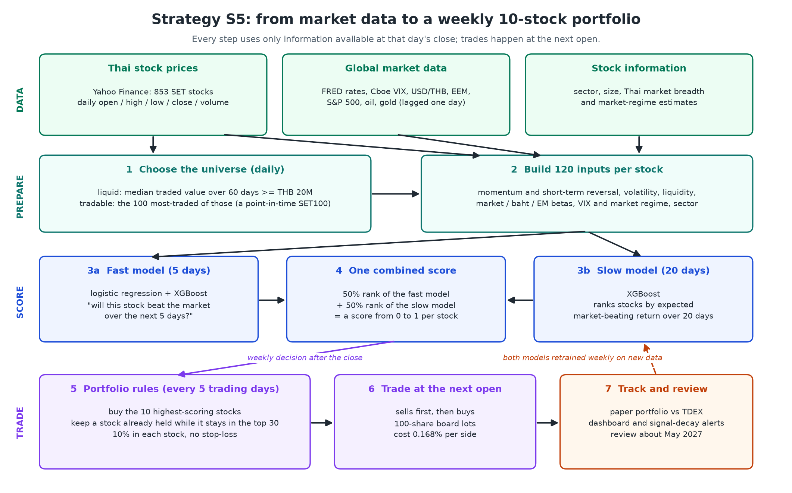

# Strategy S5: how it works

S5 is the strategy this project deploys. It is the best design found across 795 tested versions.

* **What it does.** Every week it ranks the 100 most-traded Thai stocks with two machine-learning models. It then holds
  the 10 best, in equal amounts.
* **Status.** It is registered for live paper trading (fake money, real prices) from 2 November 2026, under rules
  frozen at 2026-11-02T10:56:17Z.
* **Results.** How well it did, and how sure we are, is in [result.md](result.md).

## The idea in plain words

1. **Stock prices are not a random walk over a few days.** Stocks that just fell sharply tend to bounce back a little,
   and stocks that have outperformed for months tend to keep going. Volatility, liquidity, the baht and global risk
   mood also tilt the odds.
2. **No single rule captures all of this.** So a model learns it from 2010 onward, using 120 inputs per stock per day.
   Its job is to sort stocks from "most likely to beat the market next week" to "least likely".
3. **Being right a little more often than not is enough** if it is applied to many stocks, every week, for years.
   * The model's ranking is right only modestly more often than chance: the correlation between its rank and the
     realised return is about 0.05.
   * But that edge has held in every year from 2013 to 2026.
4. **Trading costs are the enemy.** Buying and selling a Thai stock costs about 0.17% each way. Trading every day would
   eat the whole edge, so S5 trades once a week and avoids selling stocks that are still good enough.

## Step by step

| Step | What happens | Why |
| --- | --- | --- |
| **1. Universe** (daily) | Keep stocks whose median traded value over 60 days is at least THB 20M. Of those, take the 100 most traded: a point-in-time SET100 | Only stocks that can be traded without moving the price. The list is rebuilt each day from that day's data, so no future knowledge leaks in |
| **2. Inputs** (daily) | 120 numbers per stock: returns over 1 day to 6 months, short-term reversal, residual momentum, volatility, liquidity, betas to the Thai market, the baht and emerging markets, VIX and market-regime probabilities, sector, calendar | Each captures an effect documented in finance research. US and global data are lagged one day, so they are known at the Thai close |
| **3a. Fast model** | Logistic regression + XGBoost predict the probability that each stock beats the market (beta-adjusted) over the next 5 days. Their daily ranks are averaged | The core stock-picking signal. Two different model types are steadier than one |
| **3b. Slow model** | XGBoost ranks stocks by expected market-beating return over the next 20 days | The edge lasts beyond 5 days. A slower signal changes less week to week, so the portfolio trades less |
| **4. Combined score** | Score = 50% rank of the fast model + 50% rank of the slow model, from 0 to 1 | The walk-forward selection chose this blend every year from 2021 |
| **5. Portfolio rules** (every 5 trading days) | Buy the 10 highest scores. Keep a stock already held while it ranks in the top 30. 10% of the portfolio in each stock. No stop-loss | The top-30 "buffer" roughly halves turnover and was the single most valuable rule tested. Stop-losses did not help robustly. Holding 20 or 30 stocks lowered returns |
| **6. Execution** | Orders are decided after the close and filled at the next morning's open. Sells go first, in 100-share board lots. Cost 0.168% per side (commission 0.15% + exchange fees + VAT) | Realistic for a Thai retail investor. No trade uses a price that was not yet available |
| **7. Track and review** | The paper portfolio is marked daily against TDEX (the SET50 ETF). A signal-decay monitor raises alerts | Live data no test has seen is the only clean proof. Review about May 2027 |

**Retraining.**
* Both models are refit weekly on all history to date (the Airflow weekly job).
* The model design itself (inputs, model types, settings) is frozen. Only the fitted weights update.

## A week in the life of S5

1. **Decision day, after the close.**
   * The daily job downloads prices and global data and recomputes the 120 inputs.
   * Both models score all 100 stocks, and the scores are logged before any trade (point-in-time record).
2. **Ranking.**
   * Stocks held that are still in the top 30 stay.
   * Stocks that fell below 30th are sold.
   * The freed slots are filled with the highest-ranked stocks not yet held, so the portfolio is back to 10.
3. **Next morning's open.** Orders execute. A typical week swaps one or two names, which adds up to about 11×
   portfolio turnover a year.
4. **Every day.** The portfolio's value, trades and scores are appended to an append-only ledger, and the dashboard
   updates.

The decision day is every 5th trading day of the year, not a fixed weekday. The caveats below explain why this
matters.

## Why this design and not another

S5 was not hand-picked. Its rules came from a walk-forward selection (`experiments/integrated_v1`):
* each January, the best of 576 designs was chosen using only earlier years;
* by the 2026 selection the winner was this one, and it was registered unchanged as S5.

The November 2026 experiments then tried to beat it with professional LSEG data and new ideas. None held up in both
2013-21 and 2022-26:

| Alternative | Outcome |
| --- | --- |
| Add analyst forecasts, value ratios, earnings surprises, price targets, ESG (13 signals) | Better in 2013-21, worse in 2022-26 |
| Let signal weights adapt to recent performance | Adapted too late |
| Hold 20 or 30 stocks | Lower return, not steadier |
| Rebalance every 10 or 21 days | Results jump around with no pattern |
| Mean-variance or cost-aware optimisers instead of equal weight | Did not beat equal weight after costs |
| Add an 8% stop-loss | Not robust |

## What to expect, and the caveats

* **Return.** The walk-forward record, 2016-26 after costs, is 7.4% a year vs 7.2% for TDEX, with a smaller worst
  fall (−35% vs −37%). This is roughly market-level, with about 60% of the market's ups and downs.
  * That record held a literature-factor portfolio in 2016-20, because the yearly selection preferred it then.
    It held S5's rules from 2021.
  * S5's fixed rules alone earned 13.0% a year over 2013-26, against 4.8% for TDEX. That figure is chosen with
    hindsight.
* **Which day it rebalances matters.** Running the same rules on each of the 5 possible decision days gives 11.4% a
  year on average for 2013-26, against 13.0% on the standard day, so part of the backtest is luck.
* **Delisted stocks.** These were missing from the free data and would lower results by up to 1-2 points a year.
* **When it does badly.** In sharp market falls (it is fully invested and has no stop-loss), and when the market rewards
  slow "value" stocks over the momentum and reversal patterns the model favours, as in parts of 2022-26.
* **What would change the decision.** Live results at or above TDEX after 6-12 months, or a cheaper broker. Costs are
  about 40% of the edge.

## Where it lives in the code

| Piece | File |
| --- | --- |
| Universe and inputs | `src/setalpha/transform.py` (`liquid`, `tradable`, features) |
| Fast model (logistic + XGBoost) | `src/setalpha/model.py`, `models/logit.joblib`, `models/xgb.joblib`, `models/meta.json` |
| Slow model and combined score | `src/setalpha/paper.py` (`fit_slow`, `day_scores`: `pred_blend`) |
| Portfolio rules and execution | `src/setalpha/paper.py` (`Shadow("S5 ...")`, `execute`), `src/setalpha/strategy.py` |
| Frozen registration | `paper.SHADOWS`, `paper.DEPLOYED`; selection protocol `experiments/integrated_v1/output/protocol_frozen.txt` |
| This figure | `docs/strategy_flow.py` → `docs/strategy_flow.png` |
